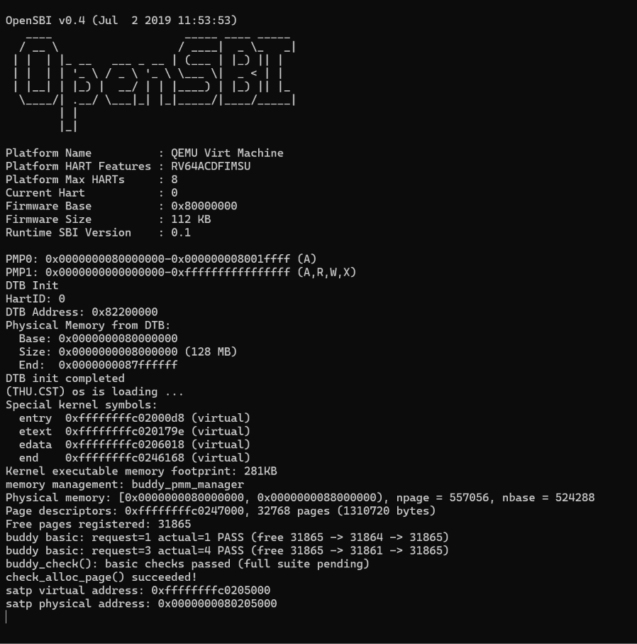
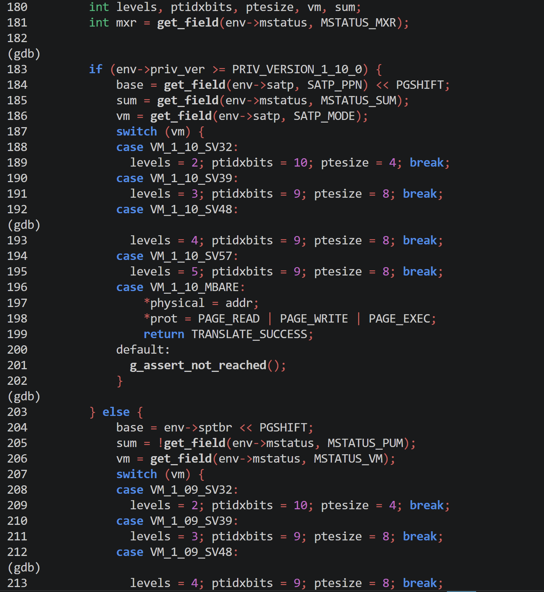

# lab2实验报告

# 实验报告

## 实验基本信息

|项目|内容|
|---|---|
|**实验名称**|Lab2:物理内存和页表|
|**小组成员**|2510820\-侯思佳、2510725\-杨欣媛、2514207\-姜雨涵|
|**完成日期**|2026\.10\.23|

### 小组分工

练习分工

|成员|负责的练习/模块|
|---|---|
|2510820\-侯思佳|功能模块一：物理内存初始化功能<br>任务一：实现物理内存探测与页描述符初始化功能<br>扩展任务 Challenge：硬件的可用物理内存范围的获取方法|
|2510725\-杨欣媛|功能模块二：物理内存分配功能<br>任务一：理解first\-fit 连续物理内存分配算法<br>任务二：实现 Best\-Fit 连续物理内存分配算法|
|2514207\-姜雨涵|功能模块二：物理内存分配功能<br>任务三：buddy system（伙伴系统）分配算法|

实验报告分工

|成员|负责的练习/模块|
|---|---|
|2510820\-侯思佳|功能模块一，实验总结与收获|
|2510725\-杨欣媛|实验目的，功能模块二，实验总结与收获|
|2514207\-姜雨涵|功能模块二，实验整体逻辑分析|

---

## 一、实验目的

本实验的主要目的是：

1. 理解页表的建立和使用方法

2. 理解物理内存的管理方法

3. 理解页面分配算法

---

## 二、实验环境

|成员|AI 编程工具|底层模型|备注|
|---|---|---|---|
|2510820\-侯思佳<br>|Claude Code|DeepSeek\-V4\-Flash||
|2510725\-杨欣媛|Claude Code\(终端\)|DeepSeek\-V4\-Flash||
|2514207\-姜雨涵|Codex|GPT\-6\.1 Sol||

---

## 三、实验整体逻辑分析

### 2\.1 本章节的逻辑主线

- 本章围绕**物理内存的页级管理**展开，**核心问题是**：内核如何识别可用物理内存，保护已经占用的区域，并根据申请需求分配、回收连续的物理页。

- **架构逻辑**：整个实验先建立物理页面的描述和初始化机制，再通过理解 First\-Fit、完善 Best\-Fit、实现 Buddy System，研究不同的空闲空间组织、查找、拆分和合并方式，最后通过测试检查分配与回收是否符合约定。

- **运行逻辑**：内核先选择并初始化一个物理内存管理器，再建立 `Page` 描述符数组，将可用页面交给该管理器，最后执行其检查函数。上层统一通过 `alloc_pages()`、`free_pages()` 等接口操作内存。First\-Fit、Best\-Fit 和 Buddy 是并列策略，一次启动选择其中一种。

### 2\.2 功能的逐步实现

1. **功能模块一：首先完成物理内存初始化。**

    1. 先从设备树获取物理内存范围，然后建立 `Page` 描述符数组（先将所有页面标记为保留，再排除固件、内核和描述符数组占用），最后将剩余区域按页对齐后交给分配器。

    2. 首先完成这一部分，是为了明确哪些页面可以分配，避免后续算法覆盖内核或访问非法范围。接下来就要开始加入具体的分配算法以跑通整个内存管理流程。

2. **功能模块二：理解已有的First\-Fit并随后完善Best\-Fit。**

    1. First\-Fit 用空闲链表记录连续页面块，申请时选择第一个足够大的块，必要时拆分；释放时插入空闲链表，并合并相邻区间。通过理解这一参考实现，可以掌握管理器接口、页面标志、空闲计数和链表操作，为其他算法提供了理论基础。

    2. 完成Best\-Fit：在已有的链表管理方式上，将选择规则改为遍历所有候选块，选出能够满足请求的最小块，再完成分配、拆分和回收。这一步主要体现了，在保持统一接口的前提下，如何通过改变选择策略影响空闲空间的使用。

3. **功能模块三：实现并接入另一种算法：Buddy System。**

    1. 先明确请求取整、原请求释放和绝对物理页号等约定，再按阶建立空闲链表。申请时将页数向上取整为 2 的幂，通过拆分大块满足请求；释放时仅与同阶且互为伙伴的空闲块合并。

    2. 这一步的实现，便从一般连续区间管理，过渡到具有固定大小等级和明确合并规则的管理方式。

4. **最后补充分阶段测试与回归验证。**

---

## 四、实验内容与实现

### 功能模块一：物理内存初始化功能

**负责人：2510820\-侯思佳**

#### 任务一：实现物理内存探测与页描述符初始化功能

#### 模块功能描述

**需要实现/修改的函数：**

```C
static void page_init(void)
```

**功能说明：**

1. 该模块在整个系统中的作用：

物理内存初始化模块是操作系统内存管理的基础，负责在内核启动阶段探测系统的物理内存范围，建立物理页描述符数组，并初始化可用物理页面的管理状态。模块通过读取设备树中的物理内存信息，确定内核能够管理的物理内存范围，排除 OpenSBI、内核镜像及页描述符数组自身占用的空间，再将剩余的完整空闲物理页面注册到物理内存管理器中，为后续连续物理页面的分配与回收提供基础。

2. 需要处理的主要场景：

- 物理内存探测： 获取设备树提供的物理内存起始地址和大小，检查内存信息的有效性，并根据框架规定的物理内存上界确定实际可管理范围。

- 页描述符初始化： 根据可管理的物理页面数量计算页描述符数组的大小和存放位置，正确设置 `va_pa_offset`、`npage` 和 `pages`，区分虚拟地址、物理地址及物理页号。

- 内存占用区域排除： 避免将 OpenSBI、内核镜像、页描述符数组及其他已占用区域登记为空闲内存，防止后续分配覆盖正在使用的数据。

- 空闲页面注册： 对空闲区域进行页面对齐，计算可用完整物理页面的数量；只有存在可用完整页面时，才调用 `init_memmap()` 将其交给当前物理内存管理器。

- 异常情况处理： 对无效的设备树信息、地址计算溢出、内存范围不合法以及描述符数组空间不足等情况进行检查，必要时通过 `panic()` 终止初始化。

3. 与其他模块的交互关系：

- 与物理内存管理器初始化模块的关系： `pmm_init()` 负责组织物理内存管理器的初始化流程，并调用 `page_init()` 完成物理内存的探测、页描述符数组的建立和空闲物理页的初始化。

- 与空闲物理页管理模块的关系： `page_init()` 在确定可用物理内存范围后，通过 `init_memmap()` 将符合条件的空闲物理页交给具体的物理内存管理算法进行管理，为后续物理页的分配与回收提供基础。

- 与物理页分配和释放模块的关系： 初始化完成后，其他模块可以通过 `alloc_pages()` 和 `free_pages()` 等接口申请和释放物理页。物理内存初始化模块通过正确划分保留区域与空闲区域，保证这些操作能够在有效的内存范围内进行。

#### 最终提示词

以下是生成最终提示词前的spec：

```Markdown
Spec：物理内存探测与页描述符初始化功能
1. 任务目标
在 kern/mm/pmm.c 中实现 page_init() 函数，根据设备树获取物理内存范围，计算物理页数量，初始化页描述符数组，并将可用物理页面交给当前物理内存管理器管理。
2. 功能需求
获取物理内存的起始地址和大小，检查内存信息是否有效。
正确设置 va_pa_offset、npage 和 pages，完成物理页描述符初始化。
排除 OpenSBI、内核镜像和页描述符数组占用的空间，将完整空闲页面通过 init_memmap() 注册到物理内存管理器。
正确处理地址转换、页面对齐和内存边界，避免将已占用的内存登记为空闲区域。
内存信息无效时终止初始化；没有可用的完整空闲页面时，不调用 init_memmap()。
3. 实现约束
使用现有内存管理框架提供的接口、数据结构和宏，保持与项目代码兼容，不修改其他模块的分配、释放逻辑。
4. 验收标准
代码能够正常编译；关键全局变量设置正确；空闲页面注册符合内存范围、对齐和占用情况；通过适当的测试或检查验证实现结果，并如实记录测试情况。
```

以下是经过迭代优化后，最终成功实现该功能的提示词：

```Markdown
完成操作系统实验的任务一：实现物理内存探测与页描述符初始化功能。

阅读并理解lab2文件夹中的 `kern/mm/pmm.c`、`kern/mm/default_pmm.c`、相关头文件和 Makefile，了解现有的内存管理代码及其实现的功能。

然后在 `kern/mm/pmm.c` 文件中合适位置实现 `static void page_init(void)`函数，
实现以下功能：
1.根据设备树提供的物理内存信息获取物理内存的起始地址和大小。
2.计算物理页的数量，初始化页描述符数组。
3.把排除OpenSBI、内核镜像和描述符数组占用空间后的完整空闲页面使用已有的`init_memmap()` 函数交给当前pmm_manager管理，为后续页面分配提供正确的初始状态。
4.对每个空闲区间正确进行页面对齐和边界检查，并使用已有的 init_memmap() 将有效空闲页交给当前 pmm_manager 管理；如果存在多个互不连续的空闲区间，应根据实际内存布局分别注册，不得把中间的已占用区域包含在空闲区间内。
4.正确处理地址转换、内存边界和页对齐，避免把已经占用的内存当作空闲内存。

函数接口声明：
1.page_init() 不接收参数也不返回结果，由pmm.init()调用。
2.成功返回时应正确设置va_pa_offset（记录内核虚拟地址与物理地址之间的转换关系）、npage（记录整个物理内存范围内有多少个物理页）和pages（指向页描述符数组，也就是每一页的登记册）
3.输出探测到的物理内存范围，并完成当前物理内存管理器初始空闲区的注册

函数实现约束与可用资源：
1.必须区分虚拟地址、物理地址、物理页号和Page描述符地址。
2.正确处理内存范围与页对齐，不能把已经占用的内存当成空闲内存。
3.设备树信息无效时终止初始化。
4.无可用完整页面时不得调用init_memmap()。
5.实现过程中可以使用get_memory_base()、get_memory_size()、panic()、cprintf()、init_memmap()、pa2page()、链接符号end、struct Page及相关全局变量，并使用框架提供的内存上界、地址转换、页面对齐和页面状态宏完成初始化。


修改过程需满足以下要求和限制：
1.优先只增加完成任务所必需的代码，不要修改其他模块。
2.不要修改 `default_pmm.c`和其他文件里所有已有的分配、释放、测试函数、宏文件以及数据结构。
3.必须在项目文件里实际修改你的代码，而不是仅仅展示你的代码。
4.完成后，检查代码并尝试编译、运行测试，确认实现是否正确，测试代码不要直接写在文件里。
5.如果编译或测试失败，根据实际报错分析原因并修复。
6.不要编造测试结果。如果无法运行，请告诉我具体原因和手动验证方法。

用简单易懂的话告诉我：你修改了哪些代码、每部分有什么作用、编译是否通过、运行测试是否通过。
最后把修改的地方单独给我写出来
```

### Challenge：硬件的可用物理内存范围的获取方法

**负责人：** 2510820\-侯思佳

如果操作系统在编译或启动前无法提前知道当前硬件的可用物理内存范围，可以在系统启动过程中，通过固件提供的硬件信息、设备树（Device Tree）或硬件探测机制动态获取物理内存的起始地址、大小以及保留区域，从而确定操作系统能够使用的物理内存范围。

具体方法如下：

1. 通过设备树（Device Tree）获取。 在 RISC\-V 等平台上，固件可以在启动时向操作系统传递设备树（DTB）。操作系统解析设备树中描述物理内存的节点，读取 `reg` 属性，获得内存区域的起始物理地址和大小。结合设备树中的保留内存信息以及内核自身的内存布局，即可确定可供操作系统管理的物理内存范围。本实验可以通过 `get_memory_base()` 和 `get_memory_size()` 等接口获取相关信息。

2. 通过固件接口获取。 操作系统可以利用启动固件提供的内存信息接口获取可用物理内存区域。例如，UEFI 系统可以通过 `GetMemoryMap()` 获取内存区域的起始地址、长度和内存类型，再根据内存类型筛选可供操作系统使用的区域。在 RISC\-V 平台上，也可以根据 SBI 启动环境及相关平台约定获取必要的硬件信息。

3. 通过硬件探测机制获取。 如果设备树和固件没有提供完整的内存信息，操作系统还可以结合平台相关的硬件寄存器、内存控制器信息或特定的内存探测机制，识别实际存在的物理内存区域。不过，这种方法依赖具体硬件平台，不能简单地对所有物理地址进行读写测试，否则可能访问无效地址或影响硬件状态。

获取内存范围后，操作系统还需要进一步处理：排除固件、内核映像、页描述符数组以及其他设备保留区域所占用的内存，并按照页大小进行地址对齐，最终将剩余的完整物理页加入空闲物理页管理器。

### 功能模块二：物理内存分配功能

**负责人：** 2510725\-杨欣媛

#### 任务一：理解first\-fit 连续物理内存分配算法

1. **First\-Fit 分配器如何初始化空闲页、分配连续物理页、回收页面并合并相邻空闲块?**

- 初始化：`default_init` 把空闲链表置空、`nr_free` 清零，准备“账本”。`default_init_memmap(base, n)` 把 `page_init()` 算出的空闲区首次注册：遍历 `n` 个页，确认它们是保留状态后清空标志和引用计数；把 `base` 设为块头，`property = n`，表示后面跟着n个连续的空闲页；标记 `PG_property`，`nr_free += n`；最后按地址升序把块头插入空闲链表。只有块头在链表上，块内其他页不在。

- 分配：`default_alloc_pages(n)` 先检查 `nr_free` 是否足够，不够返回 `NULL`。然后从头遍历空闲链表，找第一个 `property >= n` 的块。找到后从链表摘除；如果块比需求大，就拆分：前 `n` 页分配出去，剩余部分成为新块，记录新大小并插回链表。最后 `nr_free -= n`，清除分配出去页的块头标志，返回块头。

- 回收：`default_free_pages(base, n)` 遍历 `n` 个页，确认它们是已分配状态后清空标志和引用计数；把 `base` 设为块头，`property = n`，`nr_free += n`，按地址升序插入空闲链表。然后检查前一个块：如果 `p + p->property == base`，表示地址连续，左邻居末尾挨着目前的开头，就把 `base` 合并进前一个块，摘除 `base`。再检查后一个块：如果 `base + base->property == p`，表示右邻居挨着目前的末尾，就把后一个块合并进 `base`，摘除后一个块。

2. **原有的first fit算法是否有进一步的改进空间？**

有。可以从这些方向改进：

- 分配效率：当前从头遍历，最坏 O\(n\)；可以维护按大小排序的索引或记录最大块位置。

- 碎片控制：first fit 容易拆碎大块，可以结合 best fit 或 buddy system。

- 合并效率：目前只有在`free_pages` 被调用的那一刻，才去检查能不能和前后合并。碎片多时可以定期扫描合并。

- 并发安全：当前没有锁，多核下需要加锁或原子操作。

- 分配策略：可以按请求大小分段，小请求用 first fit，大请求用 best fit，减少大块被小请求拆碎。

#### 任务二：实现 Best\-Fit 连续物理内存分配算法

#### 模块功能描述

**需要实现/修改的函数：**

```C
static void best_fit_init(void);
static void best_fit_init_memmap(struct Page *base, size_t n);
static struct Page *best_fit_alloc_pages(size_t n);
static void best_fit_free_pages(struct Page *base, size_t n);
static size_t best_fit_nr_free_pages(void);static void best_fit_check(void);
const struct pmm_manager best_fit_pmm_manager;
static void init_pmm_manager(void);
```

**功能说明：**

1. 该模块在整个系统中的作用：物理内存分配模块是操作系统内存管理的基石。它负责从设备树探测物理内存的真实范围，建立并初始化 Page 描述符数组，并实现具体的页面分配与释放算法，为后续的虚拟内存管理和进程管理提供物理页面支持。

2. 需要处理的主要场景：

    - 系统启动时：获取物理内存边界，排除 OpenSBI 固件、内核镜像和 Page 描述符数组本身占用的空间，将剩余的完整物理内存页注册到空闲链表。

    - 动态分配时：处理大小不同的连续物理页申请。Best\-Fit 算法需要遍历空闲链表，找到满足请求的最小块，并在分配时对过大的块进行拆分。

    - 动态释放时：将页面归还给空闲链表，并按地址顺序插入。同时检查与前后物理块是否地址连续，若连续则进行合并，以减少外部碎片。

3. 与其他模块的交互关系：

    - 向下：通过 `pmm_manager` 的函数指针接口，实现了不同分配算法的可插拔；使用 `libs/list.h` 提供的双向循环链表管理空闲块。

    - 向上：为 VMM和内核其他子系统提供统一的 `alloc_pages()` 和 `free_pages()` 等接口。

    - 与驱动层交互：通过 `driver/dtb.c` 提供的接口读取 DTB 中的物理内存信息。

#### 最终提示词

以下是生成提示词前的SPEC：

```C++
1.第一阶段
依赖关系定义：明确要求 AI 必须参考 pmm.h（接口定义）和 default_pmm.c（First-Fit 参考实现）。
状态约定约束：强制要求分析 basic_check() 和 best_fit_check() 对 PG_property 标志位及 nr_free 计数的预期，并绝对禁止修改测试函数，确保生成代码能严丝合缝地接入现有框架。
2.任务一：page_init
编译与声明：必须在 pmm_init() 之前定义 page_init，或添加前置声明，杜绝 C 语言隐式声明报错。
地址计算与对齐：必须区分虚拟/物理地址，用 PADDR(end) 算物理地址。描述符数组起点和内存末端必须严格页对齐（ROUNDUP/ROUNDDOWN）。
状态流转：必须先对所有物理页调用 SetPageReserved 置为保留态，算出合法空闲区 [free_start, free_end) 后，再通过 init_memmap 注册真正的空闲页。
3.任务二：best_fit_pmm.c
核心算法差异：【强约束】分配时必须遍历完整链表，找“最小的、且 property >= n 的块”，防止逻辑退化为 First-Fit。
标志位管理：在分配拆分块或释放合并块时，必须精准调用 ClearPageProperty 和 SetPageProperty，确保块头标志位流转正确。
接口完整性：需完整实现 init、init_memmap、alloc_pages、free_pages、nr_free_pages、check 六个核心函数。
系统集成：必须注册 best_fit_pmm_manager，并在 pmm.c 中将其切换为当前管理器。
```

以下是经过迭代优化后，最终成功实现该功能的提示词：

```Markdown
我正在做操作系统实验 lab2 的物理内存分配模块，包含两个任务。请先阅读并理解现有框架，然后直接修改对应的文件：

【第一阶段：阅读理解与框架分析】
请先阅读以下文件：
1. kern/mm/pmm.h：理解 struct pmm_manager 的接口定义。
2. kern/mm/default_pmm.c：理解 First-Fit 的参考实现（空闲链表管理、块拆分与合并）。
3. kern/mm/best_fit_pmm.c：查看 basic_check() 和 best_fit_check() 这两个测试函数，分析它们对 Page 状态（如 PG_property 标志位、nr_free 计数）的硬性约定，不得修改这两个测试函数。

【第二阶段：代码实现】
任务一：在 kern/mm/pmm.c 中实现 static void page_init(void)
1. 确保 page_init 函数定义在 pmm_init() 之前，或者在文件开头加上 `static void page_init(void);` 的声明，解决隐式声明报错。
2. 使用 get_memory_base() 和 get_memory_size() 读取内存信息，无效则 panic()。
3. 根据 end 符号的虚拟地址用 PADDR(end) 算物理地址并向上页对齐，计算描述符数组的结束地址。
4. 设置好 npage、va_pa_offset 和 pages 指针。
5. 先把所有物理页标记为保留（SetPageReserved），再计算空闲区起点（描述符数组之后页对齐）和终点（内存末端向下页对齐）。
6. 如果 free_start < free_end，调用 init_memmap(pa2page(free_start), free_pages)。

任务二：在 kern/mm/best_fit_pmm.c 实现 Best-Fit
1.参考 default_pmm.c 实现完整的函数：init, init_memmap, alloc_pages, free_pages, nr_free_pages, check。
2.注册 const struct pmm_manager best_fit_pmm_manager。
3.【核心要求】分配时，遍历完整链表，找“最小的、且 property >= n 的块”。
4.在分配（拆分块）后要正确调用 ClearPageProperty 清除分配页的标志，设置剩余块的新块头标志；释放合并时同理。
5.在 kern/mm/pmm.c 的 init_pmm_manager 中切换为 best_fit_pmm_manager。
```

#### 实现迭代过程

本模块的实现经历了1次迭代，过程如下：

---

##### 第一次迭代

**最终结果：**

经过1次迭代，该模块最终：

- ✅ 编译通过：终端无警告和报错，`pmm.c` 成功编译并生成 `ucore.img`。

- ✅ 所有相关测试通过：内核成功跑通并输出 `check_alloc_page() succeeded!`，证明 Best\-Fit 算法的分配、回收、合并以及 `Page` 状态标志的流转均符合测试函数的严格校验。

- ✅ 功能符合预期：

1. 成功从 DTB 中探测到物理内存：`Base: 0x80000000, Size: 128 MB`。

2. 成功切换并初始化了 Best\-Fit 管理器：`memory management: best_fit_pmm_manager`。

3. 准确计算了描述符布局：`npage = 557056`，描述符数组占用 `1310720 bytes`，完美避开了内核和描述符占用区。

4. 成功注册空闲页：`Free pages registered: 31929`，物理内存初始化与页面分配完全正常。

---

**Best\-Fit 算法是否有进一步的改进空间？**

有。

1. 查找效率问题：当前每次分配都要遍历整个链表，时间复杂度为 O\(n\)。可以按块大小维护多个分离的空闲链表，或引入红黑树等数据结构，将查找时间降至 O\(log n\)。

2. 外部碎片问题：Best\-Fit 容易将大块切碎，产生难以利用的极小碎片。可以设置拆分阈值，若剩余部分太小则放弃拆分，直接将整块分配出去。

3. 合并开销问题：当前每次释放都立即合并相邻块，频繁释放时开销较大。可采用延迟合并策略，释放时先标记，待分配找不到合适块时再统一扫描合并。

4. 并发安全问题：当前实现仅针对单线程，未考虑多核并发。在实际系统中需加锁，或引入 Per\-CPU 缓存来减少锁竞争。

---

### 功能模块二：物理内存分配功能

**负责人**：2514207\-姜雨涵

#### 任务三：buddy system（伙伴系统）分配算法

#### 模块功能描述

**part1：需要实现/修改的函数**

```C
// Buddy 的五个资源管理接口
static void buddy_init(void);
static void buddy_init_memmap(struct Page *base, size_t n);
static struct Page *buddy_alloc_pages(size_t n);
static void buddy_free_pages(struct Page *base, size_t n);
static size_t buddy_nr_free_pages(void);

//在现有管理器选择位置增加 Buddy 分支 
static void init_pmm_manager(void);
```

**part2：功能说明**

1. **该模块在系统中的作用**：本模块负责对可用物理内存进行页级管理，通过按阶组织空闲块，实现连续物理页的初始化登记、申请、拆分、释放和伙伴合并

2. **需要处理的主要场景：**

    1. 初始化—分配—释放流程

    拆分和合并过程中，内部辅助函数负责同步维护链表、首页标志和 `property`，使最终空闲块进入正确阶的链表。

    2. 新增设计：申请和释放时的页数约定

    申请 n 页，实际占用不小于 n 的最小 2 的幂 b 页。例如：

    ```C
    struct Page *p = alloc_pages(3);  // 实际占用 4 页
    free_pages(p, 3);                // 使用原请求 3，归还整个 4 页块
    ```

    分配后，首页的 `requested_n` 保存 3，空闲数减少 4；释放后记录清零，空闲数增加 4。不能将释放参数改成 4，也不支持部分释放、中间指针释放或重复释放。

    注意：正整数请求超出容量、空闲不足或没有合适块时返回 `NULL`，保持管理状态不变；零请求和非法初始化、释放通过断言拒绝。页面引用计数按框架约定初始化为 0，不承诺清零物理页数据。

    3. 伙伴计算与合并规则

    对大小为 b 页的块，使用绝对物理页号计算：

    ```Plain Text
    块首页对齐要求：ppn % b == 0
    伙伴页号：buddy_ppn = ppn XOR b
    ```

    只有伙伴完整范围合法、非保留、为空闲首页且大小相同时才能合并。必须先检查范围，再访问伙伴描述符，不能跨未登记页面或保留区域合并。

    注意：相邻不一定互为伙伴。例如起始页号按 4 对齐时，索引 1 的单页伙伴是 0，索引 2 的伙伴是 3，因此索引 1、2 即使同时空闲也不能合并。

3. **与其他模块的交互关系**：

    1. 与物理内存初始化模块的交互

    运行时先选择管理器并调用 `buddy_init()`，随后 `page_init()` 建立描述符数组，排除固件、内核和描述符占用，再通过以下链路交付可用页面：

    ```Plain Text
    page_init()
      → init_free_pages()
      → init_memmap()
      → buddy_init_memmap()
    ```

    2. 而Buddy与First\-Fit，Best\-Fit 是并列的分配策略，共用 `struct pmm_manager` 接口。上层仍通过 `alloc_pages()`、`free_pages()` 和 `nr_free_pages()` 操作物理页。工程默认选择 Best\-Fit，只有当显式使用 `PMM=buddy` 时启用 Buddy。

#### **测试覆盖的核心行为与边界情况：**

- 初始化与区间登记：检查空池、不对齐起点、非 2 的幂长度、多次登记和空洞，验证页面不丢失、不重复，也不会跨未登记区域合并。

- 分配与取整：同时申请 1、2、3、4、5、8 页，核对实际占用、地址对齐、范围及不重叠，验证按实际块大小扣减空闲页数。

- 拆分与伙伴合并：将大块拆成单页，以不同顺序释放后重新申请完整大块；同时检查相邻但非伙伴的页面不能合并，验证合并依据是伙伴关系。

- 失败与数值边界：覆盖耗尽、总量足够但碎片导致失败、各阶至最大阶、超容量请求、`size_t` 最大值和描述符末端，检查失败返回 `NULL` 且公开状态不变。

- 重复使用与非法调用：执行 32 轮申请释放，确认计数恢复和大块能力；11 个负向模式分别检查零请求、越界、错误指针、错误释放数量及重复释放是否触发对应断言。

#### 这些测试为什么能有效检验buddy system的正确性

这些测试使用**独立计算的预期值**，同时检查返回结果、页面元数据、计数和后续分配能力，避免只凭一次成功或总数正确判断实现。

#### 最终提示词

1. **说明spec和prompt是如何写的？**

- spec 的编写说明

本任务的 spec 以现有 `pmm_manager` 接口和物理内存初始化流程为边界，重点明确了Buddy分配器应满足的行为约定。spec首先规定按阶组织空闲块、使用绝对物理页号计算伙伴，以及保留公共 `Page` 布局；随后明确请求向上取整、按原首页和原请求整块释放、空闲计数按实际占用维护等规则。例如，申请 3 页实际占用 4 页，但释放参数仍为 3。接下来，文档再按各接口的前置条件、后置条件和边界情况展开，使分配失败、非法释放和多次登记等行为都能有明确的验收依据。

- prompt 的编写说明

prompt在上述spec基础上，将工作拆成“生成模块”和“生成测试”两个阶段（2份prompt）：

第一份prompt提供真实源码路径、现有接口和必须保留的代码范围，要求生成独立的 Buddy 实现、接入构建，并实际执行基础验证。第二份将spec转成确定性测试，要求覆盖取整、拆分合并、碎片、数值边界和非法调用，并单独记录结果。两份提示词均使用 `[PROMPT]`、`[RELY]`、`[GUARANTEE]` 和 `[SPECIFICATION]`，分别组织任务要求、上下文依赖、必须交付的函数列表和具体行为约束。

2. **spec：**

```Plain Text
1. 接口与范围
沿用 pmm_manager 六个接口，保留公共 Page 布局和原初始化逻辑。适用于单核启动阶段的串行调用。
2. 状态组织
按阶维护空闲链表，order-k 对应 2^k 页块；维护真实空闲页数。只有空闲首页设置 PageProperty，property 保存实际块大小；私有静态数组记录原申请页数。
3. 初始化
init() 清空内部状态，不访问尚未建立的描述符。init_memmap() 支持不规则区间和多次登记，验证后拆成合法对齐块，不丢页、不跨保留区域合并。
4. 分配
请求 n 页向上取整为 b 页，从最小可用阶取块，必要时逐级拆分，空闲数减少 b。合法请求无法满足时返回 NULL，状态不变；零请求通过断言拒绝。
5. 释放与合并
必须使用原首页和原请求整块释放。例如申请 3 页实际占用 4 页，仍用 free_pages(p,3) 释放。伙伴按绝对页号 ppn XOR b 计算，仅合并范围合法、同阶且空闲的伙伴；空闲数增加 b 一次。错误首页、错误请求数和重复释放均拒绝。
6. 验证要求
检查初始化、取整、拆分合并、不重叠、计数、碎片和数值边界；非法调用单独启动验证对应断言，并回归普通 Buddy 和 Best-Fit。
```

3. **第一份prompt：**

```C++
[PROMPT]

****任务****：在当前 RISC-V uCore Lab2 工程中实现页级 Buddy System，并接入内核。已有物理内存初始化和 Best-Fit，本次只新增 Buddy。先完成模块和基础自检，完整测试由第二份提示词完成。本文已包含必要的背景和设计约定，配合已有工程源码使用，不需要另附说明文件或历史验证记录。

文件分工如下，所有路径都相对工程根目录：

- `kern/mm/buddy_pmm.c`：初始化、分配、释放和空闲页计数。
- `kern/mm/buddy_pmm.h`：管理器和检查入口的声明。
- `kern/mm/buddy_pmm_check.c`：真实空闲池中的基础自检。
- `kern/mm/pmm.c`：只在管理器选择处做必要接入。
- `Makefile`、`tools/dev.sh`：接入 Buddy 的编译和运行参数，保留已有功能。

****操作要求****：

1. 必须在项目中修改实际文件，不能只给代码片段。先读下面列出的相关源码，核对已有接口，再开始实现。
2. 保留 page_init()、init_free_pages()、公共 Page 布局、First-Fit、Best-Fit、basic_check()、best_fit_check()、课程评分断言和组员注释。pmm.c 只做必要的头文件和管理器选择接入。
3. 实现、声明和检查分文件。允许增加辅助函数、内部宏和变量，辅助函数及内部状态设为 static，不改变公开接口。不使用 malloc/calloc，大数组不放内核栈，不安装新环境，不硬编码内核结束地址或空闲页数。

****输出要求****：根据下面 [RELY]、[GUARANTEE]、[SPECIFICATION] 的要求修改文件，接口以真实源码为准，不加入无关功能。实际编译和运行，在回复中说明修改的文件、运行命令、关键输出和真实结果，不需要另写验证文档。未运行项明确标注，不预先填写通过结果或编造调试过程。

[RELY]

**## 1. 当前工程与可信源码**

- kern/mm/pmm.h、memlayout.h、pmm.c：接口、Page、地址转换和初始化。
- kern/mm/default_pmm.c、best_fit_pmm.c：现有分配器和原测试。
- libs/list.h、defs.h、riscv.h、kern/mm/mmu.h：链表、类型、内存起点和页大小。
- Makefile、tools/function.mk、tools/dev.sh、tools/test_lab2.c：构建、运行和课程检查。

路径均相对工程目录，接口以实际源码为准。

**## 2. 已有资源和调用关系**

下面是当前源码中与本任务直接有关的定义。使用已有头文件，不要重复定义：

```c
// kern/mm/mmu.h
#define PGSIZE 4096
#define PGSHIFT 12
// libs/riscv.h、kern/mm/memlayout.h
#define DRAM_BASE 0x80000000
#define PHYSICAL_MEMORY_END 0x88000000

struct Page {
    int ref;
    uint64_t flags;
    unsigned int property;
    list_entry_t page_link;
};

struct pmm_manager {
    const char *name;
    void (*init)(void);
    void (*init_memmap)(struct Page *base, size_t n);
    struct Page *(*alloc_pages)(size_t n);
    void (*free_pages)(struct Page *base, size_t n);
    size_t (*nr_free_pages)(void);
    void (*check)(void);
};

extern struct Page *pages;
extern size_t npage;
extern const size_t nbase;
extern const struct pmm_manager *pmm_manager;

struct Page *alloc_pages(size_t n);
void free_pages(struct Page *base, size_t n);
size_t nr_free_pages(void);
```

`pmm_manager` 有 init、init_memmap、alloc_pages、free_pages、nr_free_pages、check 六个接口。可以使用 page_ref()、set_page_ref()、page2ppn()、page2pa()、pa2page()、PageReserved 和 PageProperty 等页面标志宏，以及 libs/list.h 中的链表操作。

- 调用链为 kern_init → dtb_init → pmm_init → init_pmm_manager/init → page_init → init_memmap，之后由 check_alloc_page 调用管理器的 check。init() 先于 page_init()，不能假定 pages/npage 已就绪。
- nbase=DRAM_BASE/PGSIZE，npage 是页号上界，描述符数为 npage-nbase；page2ppn(p)=p-pages+nbase，page2pa(p)=page2ppn(p)<<PGSHIFT。合法物理页号范围为 [nbase,npage)，左端包含、右端不包含。Page 指针不是物理页数据地址。
- init_memmap(base,n) 的参数是连续物理页对应的描述符起点和页数，不是字节地址和字节数。
- 现有初始化负责排除内核、BSS 和描述符占用；交付区间可能不对齐、长度不是 2 的幂，也可能多次交付。

**## 3. 已确定的设计约束**

以下约定是本次需要实现的设计，不是已有函数：

- 第 k 阶有 2^k 页，用各阶空闲链表管理。容量 CAPACITY=(PHYSICAL_MEMORY_END-DRAM_BASE)/PGSIZE，最大阶为不超过容量的最大 2 的幂对应的阶数，链表数为最大阶加 1。描述符数量不能超过容量，这个容量不是当前空闲页数。
- 按绝对物理页号对齐。块大小为 b 页时，首页页号必须是 b 的倍数，伙伴页号为 page2ppn(base) XOR b。不能跨未登记区域或空洞合并。
- 请求 n 页，实际占用不小于 n 的最小 2 的幂页块。必须用原首页和原请求释放，例如申请 3 页实占 4 页，仍用 free_pages(p,3) 归还。不支持部分释放。
- 使用模块内部静态 requested_n[CAPACITY] 记录原请求，仅已分配首页保存 n，其余为 0。已分配块大小由原请求向上取整得到，不依赖已分配页的 property。不改公共 Page，数组放在 BSS，其占用由已有初始化排除，因此不同管理器的初始空闲页数可以不同。
- 只有空闲块首页带 PageProperty，property 为实际块页数；内部页不带首页标志。已分配页的 property 清零。空闲计数以实际页数为单位，不是块数。
- 同阶取链表首块，不保证最低地址；拆分时低地址半块继续用于分配，高地址半块保留为空闲。
- 只考虑单核启动时的串行调用，不要求增加并发机制。
- 空闲块只覆盖已登记区域，彼此及与已分配块之间不重叠，链表没有重复块，能够合并的空闲伙伴应已经合并。

**## 4. 构建与评分现状**

默认 Best-Fit；tools/dev.sh 使用现有工具链，也可通过 GCCPREFIX 或 RISCV_TOOL_CHAIN 指定工具链。kern/mm 的 C 文件自动收集。First-Fit、Best-Fit 和 Buddy 是并列管理器，一次启动只选一个。原课程检查要求选中 Best-Fit，且其内部测试包含部分释放等专属行为，不能用它替代 Buddy 测试。

[GUARANTEE]

**## 1. 新增分配模块**

新增 kern/mm/buddy_pmm.c、buddy_pmm.h、buddy_pmm_check.c，分别放实现、声明、基础检查。实现以下函数：

```c
static void buddy_init(void);
static void buddy_init_memmap(struct Page *base, size_t n);
static struct Page *buddy_alloc_pages(size_t n);
static void buddy_free_pages(struct Page *base, size_t n);
static size_t buddy_nr_free_pages(void);
void buddy_check(void);

// kern/mm/pmm.c：修改现有函数
static void init_pmm_manager(void);
```

定义 const struct pmm_manager buddy_pmm_manager，名称为 "buddy_pmm_manager"，注册上面六个 Buddy 接口。头文件只公开管理器和检查入口。

**## 2. 内核与构建接入**

保留 init_pmm_manager(void) 的签名，选择管理器后打印真实名称并调用 init()。提供 PMM=best_fit（缺省）和 PMM=buddy，只有 Buddy 模式启用选择宏。

Best-Fit 保留 obj/、bin/ucore.img；Buddy 使用 obj/buddy/、bin/buddy/ucore.img，避免切换复用旧对象。非法 PMM 报错，Buddy 执行 grade 时明确拒绝。

```bash
./tools/dev.sh PMM=best_fit
./tools/dev.sh qemu PMM=best_fit
./tools/dev.sh grade
./tools/dev.sh PMM=buddy
./tools/dev.sh qemu PMM=buddy
```

[SPECIFICATION]

**## 1. buddy_init**

****Pre-Condition****：管理器启动，描述符可能尚未建立。

****Post-Condition****：链表为空、空闲数为 0、申请记录清零，不访问 pages。

**## 2. buddy_init_memmap**

****Pre-Condition****：管理器已初始化，描述符数组已建立。正常调用要求 n>0，区间完整位于描述符数组内，全部页面仍保留。

****Post-Condition****：合法区间全部加入管理，空闲数恰增 n，保留此前登记和已有分配；空闲块满足对齐和伙伴合并约定。非法登记通过断言拒绝。

****Case 1：合法登记****：整个区间加入管理，引用计数清零，不丢尾页，不加入区间外页面。

****Case 2：多次登记****：保留旧状态，相邻区间满足伙伴条件时可以合并，中间有空洞时不能跨过空洞合并。

****Case 3：非法登记****：零长度、错误描述符指针、越界或包含已登记页面时断言拒绝，不能先改一部分状态再发现错误。

****Requirements****：修改前验证完整区间。指针尚未确认合法前，不对它做数组指针相减或解引用。

**## 3. buddy_alloc_pages**

****Pre-Condition****：管理器已初始化，正常请求 n>0，可以在空池上申请。

****Post-Condition****：成功时得到连续、对齐且不与已有分配重叠的块；失败返回 NULL，全部状态不变。

****Case 1：分配成功****：实际分配 b=ceil_pow2(n) 页，使用能够满足请求的最小可用阶，必要时拆分。每页 ref=0、没有保留或空闲首页标志，记录原请求，空闲数减 b。

****Case 2：无法满足请求****：请求或取整后的块超过容量、空闲不足，或者总量够但没有合适的连续块时返回 NULL。链表、描述符、记录和计数均保持不变。

****Case 3：零请求****：n 为 0 时断言拒绝。

****Requirements****：取整前检查容量和溢出，避免非法移位。不要求清零物理页数据。

**## 4. buddy_free_pages**

****Pre-Condition****：管理器已初始化，正常释放必须传尚未释放的原首页和原请求。例如申请 3 实占 4，释放仍传 3。

****Post-Condition****：验证后清除记录、重置页面元数据，归还实际 b 页并逐级合并；空闲数只加 b 一次。

****Case 1：不能合并****：归还整个实际块，加入对应阶，不影响其他分配。

****Case 2：能够合并****：只与同阶、空闲且互为伙伴的块逐级合并，直到不能继续，合并过程不重复增加计数。

****Case 3：非法释放****：零请求、空指针、描述符内部的错误地址、范围外指针、块中间页、部分释放、错请求数和重复释放，均通过断言拒绝。

****Requirements****：修改前验证描述符地址、记录、对齐和完整范围。伙伴整个范围检查合法后才能访问，不能把仅仅相邻的块当作伙伴。

**## 5. buddy_nr_free_pages**

****Pre-Condition****：管理器已初始化。

****Post-Condition****：无副作用返回空闲页总数，等于各空闲块实际页数之和。

**## 6. buddy_check：本阶段基础自检**

****Pre-Condition****：选中 Buddy，真实池已建立。

****Post-Condition****：资源足够时，完成 1 页和 3 页申请检查，扣减分别为 1、4，并核对范围、对齐、ref 和标志；按原请求释放后计数恢复。无法完成的项目明确标为跳过，不重建真实池。

****Case 1：资源足够****：完成对应申请和释放，实际检查通过后才输出基础 PASS。

****Case 2：资源不足****：无法完成某项检查时输出 SKIP 和原因，不能把跳过写成通过。

****Requirements****：只归还本函数申请的页面，不在正常启动触发预期 panic，不把基础自检当作完整验证。

**## 7. init_pmm_manager 与模式接入**

****Pre-Condition****：内核进入管理器选择阶段，描述符可能尚未建立。

****Post-Condition****：pmm_manager 指向选中的管理器，打印真实名称并调用其 init()；原 init→page_init→init_memmap→check 顺序保持不变。

****Case 1：默认或显式 Best-Fit****：使用原 Best-Fit，保留原课程检查行为。

****Case 2：显式 Buddy****：使用 buddy_pmm_manager，后续执行 Buddy 自己的检查。

**## 8. 整体验证与记录**

实际运行两模式构建和 QEMU、Best-Fit 原评分及模式切换，核对启动日志中 memory management 后的真实名称。另检查非法 PMM 值和 Buddy 下的 grade 是否被拒绝，这些构建参数检查不算分配器非法调用测试。QEMU 末尾循环是预期行为，取得关键输出后用 Ctrl+A、x 退出，只处理本次进程。失败按规格定位修复，在回复中分别说明构建、基础检查、原任务回归和尚待第二阶段覆盖的内容。

```

4. **第二份prompt：**

```C++
[PROMPT]

****任务****：为已经完成模块和基础自检的 Buddy 分配器补充课程测试，检查初始化、分配、释放、伙伴合并、边界情况和非法调用。先执行第一份模块生成提示词，再在同一工程中执行本提示词。本文已包含测试所需的约定，配合已有源码使用，不依赖另附说明文件或历史验证记录。

文件分工如下，所有路径都相对工程根目录：

- `kern/mm/buddy_pmm_test.c`：独立测试池、正向测试和非法调用测试。
- `kern/mm/buddy_pmm_test.h`：测试入口和模式声明。
- `kern/mm/buddy_pmm_check.c`：在 buddy_check() 中接入专用测试，保留普通模式基础自检。
- `Makefile`：增加测试模式，并分开存放各模式的编译文件和镜像。
- `tools/dev.sh`：有需要时少量调整，让现有脚本能传入测试参数。

****操作要求****：

1. 必须在项目中修改实际文件，不能只给出测试代码。先读下列源码核对接口，预期结果按下面约定独立确定，不能照抄分配器内部计算结果。
2. 保留 page_init()、init_free_pages()、公共 Page 布局、原分配器、基础自检、basic_check()、best_fit_check() 和课程评分工具。使用普通 C、数组、循环和 assert，大数组静态存储，不用 malloc/calloc、随机模型或专门读取分配器内部状态的接口。允许增加 static 辅助函数、内部宏和变量，不改变公开接口。
3. 每个测试函数前用中文说明目的、准备、操作、预期及检验原理。出现失败先记录原因，确认是实现 bug 才最小修复，不改弱断言或跳过必测项。

****输出要求****：根据下面 [RELY]、[GUARANTEE]、[SPECIFICATION] 的要求完成测试，接口以真实源码为准，不加入无关功能。在回复中用表说明测试目的、预期、实际、命令和知识点，给出关键输出，不需要另写测试结果文档。区分通过、失败、预期断言和未执行，不预先填写结果或编造调试经历。

[RELY]

****真实代码****：

- kern/mm/buddy_pmm.c、buddy_pmm.h、buddy_pmm_check.c：被测实现和基础检查。
- kern/mm/pmm.h、pmm.c、memlayout.h、mmu.h，libs/list.h、defs.h、riscv.h：实际接口、类型及页号转换。
- Makefile、tools/dev.sh、kern/debug/assert.h、kern/debug/panic.c：构建、运行和断言诊断。

****可以使用的定义和接口****：

```c
struct Page {
    int ref;
    uint64_t flags;
    unsigned int property;
    list_entry_t page_link;
};

struct pmm_manager {
    const char *name;
    void (*init)(void);
    void (*init_memmap)(struct Page *base, size_t n);
    struct Page *(*alloc_pages)(size_t n);
    void (*free_pages)(struct Page *base, size_t n);
    size_t (*nr_free_pages)(void);
    void (*check)(void);
};

extern struct Page *pages;
extern size_t npage;
extern const size_t nbase;
extern const struct pmm_manager *pmm_manager;
extern const struct pmm_manager buddy_pmm_manager;

struct Page *alloc_pages(size_t n);
void free_pages(struct Page *base, size_t n);
size_t nr_free_pages(void);
void buddy_check(void);
```

管理器的六个接口为 init、init_memmap、alloc_pages、free_pages、nr_free_pages、check。测试可调用真实管理器的初始化接口，以及公共申请、释放、计数函数。还可使用页面标志宏、page_ref()、set_page_ref()、page2ppn() 和现有链表操作，不重复定义已有结构体。

****已确定的行为****：

- 第 k 阶有 2^k 页，按绝对物理页号对齐，伙伴页号为页号 XOR 块页数。请求向上取整为不小于请求的最小 2 的幂，必须按原首页和原请求整块释放，不支持部分释放。申请 3 实占 4，释放仍传 3。
- npage 是页号上界，描述符数为 npage-nbase；nbase=DRAM_BASE/PGSIZE，page2ppn(p)=p-pages+nbase，合法页号范围为 [nbase,npage)，nbase 不改。PGSIZE=4096、DRAM_BASE=0x80000000、PHYSICAL_MEMORY_END=0x88000000，定义以对应头文件为准。容量由 (PHYSICAL_MEMORY_END-DRAM_BASE)/PGSIZE 推导，最大阶为不超过容量的最大 2 的幂对应的阶数，不硬编码实际空闲数。
- 只有空闲首页带 PageProperty，property 为实际块页数。成功分配的整个实际块每页 ref=0，没有保留或空闲首页标志。空闲计数按实际页数变化。
- 合法失败返回 NULL 且状态不变；非法调用断言拒绝。PageProperty=0 也可能是空闲内部页，不读取私有申请表作答案。
- 正常启动先调用管理器 init，再由 page_init/init_free_pages 交付保留页描述符，最后调用 check。init 不得访问尚未就绪的 pages。登记区间可能不对齐、不是 2 的幂，允许多次不重叠登记；登记参数是描述符起点和页数。只合并完整范围合法、非保留、同阶且互为伙伴的空闲块。
- 私有静态申请表及测试数组会增加 BSS，占用由原初始化自动排除。不要要求 Buddy 和 Best-Fit 初始空闲数相等，也不要修改初始化来凑页数。
- 默认管理器为 Best-Fit，显式 PMM=buddy 才选 Buddy。保留普通 Buddy 的基础自检，课程 grade 只用 Best-Fit。不能把 Best-Fit 中的部分释放测试直接套给 Buddy。
- 只考虑单核串行调用，不要求随机压力、多核或物理页内容读写测试，不声称验证了这些内容。
- 下文区间都是描述符索引，采用左闭右开写法，例如 [1,14) 表示索引 1 到 13，共 13 页。小例子从满足块对齐的位置开始；当前 nbase 满足所需对齐，测试中应检查这一点。
- panic 输出后停在循环中，不会自动退出。构建参数被拒绝不等于分配器负向测试已执行。

[GUARANTEE]

****必须实现的测试入口和函数****：

```c
void buddy_test_run(void);
static void reset_test_pool(size_t count);
static void test_initialization(void);
static void test_allocation(void);
static void test_split_and_merge(void);
static void test_failure_and_boundaries(void);
static void test_negative(unsigned int case_id);

// 修改现有检查入口，增加测试模式分支
void buddy_check(void);
```

buddy_pmm_test.h 声明测试入口，可以声明其不返回普通流程的属性。其余辅助函数和状态设为 static，模式标识与 Makefile 保持一致。

****构建接入****：提供 BUDDY_TEST=none（缺省）、positive 和下表负向模式；非 none 只允许 PMM=buddy。非法模式或参数组合报错。各专用模式使用 obj/buddy/<模式>/、bin/buddy/<模式>/ucore.img，普通模式不编入专用入口和大数组。

```bash
./tools/dev.sh qemu PMM=buddy
./tools/dev.sh qemu PMM=buddy BUDDY_TEST=positive
./tools/dev.sh qemu PMM=buddy BUDDY_TEST=free_wrong_n
./tools/dev.sh grade PMM=best_fit
```

[SPECIFICATION]

**## 1. reset_test_pool：直观、独立的测试环境**

****Pre-Condition****：仅用于专用测试启动，单核串行调用；count 大于 0 且不超过测试容量，不再需要上一个用例的分配状态。

****Post-Condition****：用静态 Page 数组作描述符，pages 指向测试数组，npage=nbase+count。真实管理器已初始化，页面全部保留、尚未登记，空闲数为 0。每例重新建立初态。

****Requirements****：常规池不超过 32 页，高阶边界可用容量推导的大数组；检查 init 在 pages/npage 未就绪时也能调用。只操作描述符，不写推导出的物理页。测试替换上下文后不返回正常内核流程，不用仅恢复 pages 的方式假装恢复分配器。

**## 2. test_initialization**

****Pre-Condition****：BUDDY_TEST=positive，每个子用例重新建立测试池。

****Post-Condition****：完成空池、不规则区间、多次登记和空洞检查，空闲数、可分配范围和保留页面均符合预期。

****Case 1：空池和不规则区间****：空池申请 1 页返回 NULL。另建至少 15 页的池，登记 [1,14) 后空闲 13 页，逐页恰好取得这 13 页，两侧仍保留。全部按原请求释放后恢复 13 页。

****Case 2：相邻区间分次登记****：登记 [0,4)、[4,8) 后空闲 8 页，能申请完整的 8 页块，释放后恢复。

****Case 3：中间有空洞****：另建池登记 [0,4)、[8,12)，中间仍保留。总空闲 8 页但申请 8 页失败，两个 4 页块仍可分别申请和释放。

**## 3. test_allocation**

****Pre-Condition****：BUDDY_TEST=positive，建立并登记对齐的 32 页池。

****Post-Condition****：同时申请 1、2、3、4、5、8 页，实占分别为 1、2、4、4、8、8 页，剩余 5 页。范围、对齐和计数正确，分配互不重叠。按原请求全部释放后恢复 32 页。

****Requirements****：检查整个实际块，包括取整多出的页面。每页 ref=0，没有保留或空闲首页标志，不要求特定返回地址。

**## 4. test_split_and_merge**

****Pre-Condition****：BUDDY_TEST=positive，每个子用例使用独立且对齐的测试池。

****Post-Condition****：证明大块能够拆分，合法伙伴能逐级合并，相邻非伙伴不会被错误合并。

****Case 1：拆分和合并****：将唯一的 8 页块拆成单页，以不同顺序释放，最后申请 8 页成功，不能只核对总数。

****Case 2：相邻但非伙伴****：4 页池分配完后，只释放索引 1、2 的页面，此时申请 2 页失败；全部归还后申请 4 页成功。

**## 5. test_failure_and_boundaries**

****Pre-Condition****：BUDDY_TEST=positive，每个子用例重新准备。常规用例使用小池，高阶用例可使用静态大池。

****Post-Condition****：完成耗尽、碎片、阶数、数值边界和反复使用检查，合法分配按原请求释放，失败不改变原状态。

****Case 1：耗尽与碎片****：逐页耗尽后再申请 1 页返回 NULL。另建 8 页池并分配完，只归还偶数索引页，空闲 4 页但申请 2 页失败；全归还后申请 8 页成功。

****Case 2：阶数和数值边界****：每个可构造阶均申请释放，包含 1 页和最大阶。覆盖有效正请求 2^k-1、2^k、2^k+1 的取整，以及分配恰好到描述符末端的情况。超过可支持块大小的请求应失败，CAPACITY+1 和 size_t 最大值返回 NULL；零请求另放负向测试。

****Case 3：失败状态不变****：在预期返回 NULL 前保存计数和小池 Page 字段，失败后比较，并检查后续分配能力。副本只用于比较，不写回去掩盖错误。

****Case 4：反复使用****：至少 32 轮同时申请 3 页和 5 页，再按原请求释放。每轮计数恢复，最后仍能申请原来的完整大块。

**## 6. test_negative：非法调用逐例启动**

****Pre-Condition****：case_id 对应有效负向模式。每例独立 QEMU，合法准备后打印 NEGATIVE START 和模式名，再调用错误接口。

****Post-Condition****：出现原因相符的 Buddy 断言并停在 panic 循环；若返回则打印 UNEXPECTED RETURN，判失败。

| 模式 | 错误调用与检查原因 |
| --- | --- |
| alloc_zero | alloc_pages(0)，零申请 |
| init_zero | init_memmap(base,0)，零登记 |
| init_overlap | 重复登记同一范围 |
| init_oob | 合法首页，长度越过描述符末端 |
| free_zero | 合法申请后 free_pages(p,0) |
| free_null | free_pages(NULL,1) |
| free_misaligned | 地址位于描述符内部 |
| free_foreign | 地址在当前描述符范围外 |
| free_middle | 申请 3 后用 p+1 释放 |
| free_wrong_n | 申请 3 后 free_pages(p,4) |
| free_twice | 同一分配释放两次 |

****Requirements****：错误指针只传参，不提前解引用。核对 START 后 Buddy 源码中的对应断言，不能把准备失败、任意 panic 或超时当通过；不声称检查了 panic 后恢复。

**## 7. buddy_test_run**

****Pre-Condition****：显式测试模式，确认镜像和管理器选择正确。

****Post-Condition****：执行选中的测试模式，结束后停在循环中，不返回普通内核流程。

****Case 1：positive****：执行全部四个正向测试函数，逐项通过才打印 PASS，全部完成后打印 BUDDY COURSE TESTS PASS。不以资源不足跳过必测项。

****Case 2：负向模式****：只调用对应的 test_negative() 用例，预期在断言处停止。

**## 8. buddy_check**

****Pre-Condition****：当前管理器为 Buddy，内核准备运行管理器检查。

****Post-Condition****：根据构建模式进入原基础自检或专用测试。

****Case 1：默认 none****：保留真实空闲池的基础检查，结束后归还申请的页面，继续原内核流程。

****Case 2：专用测试模式****：进入 buddy_test_run()，不再继续真实池基础检查或正常内核流程。

**## 通用检查与实际运行**

由常数或独立整数运算计算预期，不调用分配器自己的取整函数作为答案。正向用例扫描空闲首页，核对块大小为 2 的幂、对齐、范围、不重叠、内部页标志和空闲总数，并检查能合并的伙伴已合并。仅在唯一块例子要求特定地址，不假定同阶总取最低地址。

普通 Buddy、positive 和全部 11 个负向模式都要实际运行，在回复中给出对应关键输出。以下命令可逐例运行负向测试，每例看到 START 和对应断言后按 Ctrl+A、x，再进入下一例：

```bash
for mode in alloc_zero init_zero init_overlap init_oob free_zero free_null \
            free_misaligned free_foreign free_middle free_wrong_n free_twice; do
    ./tools/dev.sh qemu PMM=buddy BUDDY_TEST="$mode"
done
```

使用已有工具链，可通过 GCCPREFIX 或 RISCV_TOOL_CHAIN 指定位置。核对启动日志中的管理器名称和所用镜像，不能把不同模式的输出混在一起。还要检查非法模式、Best-Fit 开启专用测试、Buddy 执行 grade 时能否被拒绝，这些不计入 11 个分配器负向用例。

说明相邻非伙伴和总量足够却失败的原因。专用测试等完成标记或断言，不等 satp 输出；用 Ctrl+A、x 退出，只处理本次进程。最后回归普通 Buddy 和 Best-Fit 评分，在回复中分别说明结果。高阶测试只操作描述符，不代表真实空闲池能提供同样大小的物理块，有限用例通过也不代表所有情况正确。

```


---

### Challenge：任意大小的内存单元 slub 分配算法

**负责人：** 2510725\-杨欣媛


本实验在实现物理页分配器（Best\-Fit/Buddy System）的基础上，进一步实现了简化的 SLUB 内存分配算法。SLUB 采用两层架构：第一层复用底层的物理页分配接口，第二层在页内实现任意大小对象的切分与分配，从而避免小内存申请造成的大量页内碎片。

#### 第一份 Prompt：生成 SLUB 模块并接入内核

设计思路：向 AI 明确分层架构（底层依赖 `alloc_pages`）和核心数据结构（cache \+ freelist），要求其自由设计内部实现。

```Plain Text
我正在做操作系统实验 lab2 的扩展任务 Challenge：实现简化版的 SLUB 内存分配算法。

【已有基础】
我已经实现并切换到了 Buddy System（伙伴系统）页分配器，它提供了：
- alloc_pages(n)：分配 n 个物理页，返回 struct Page *。
- free_pages(page, n)：释放物理页。
- 页描述符 struct Page 位于 memlayout.h，包含 ref, flags, property, page_link。

【SLUB 简化设计规格】
请在 kern/mm/slub.c（新建）和 kern/mm/slub.h 中实现一个简易的两层架构分配器（不需要完全照搬 Linux，体现思想即可）：
1. 核心数据结构：
   - struct kmem_cache：代表一类固定大小的对象缓存（例如专门管 32 字节的 cache）。
   - 至少支持几种固定大小的缓存：如 16B, 32B, 64B, 128B。
   - 每个 cache 维护一个 freelist（空闲对象链表，使用指针串联空闲内存块）。
2. 接口要求：
   - void slub_init(void)：初始化各个固定大小的 cache。
   - void *kmalloc(size_t size)：根据申请大小，匹配到合适的 cache。如果该 cache 没有空闲对象，则使用底层的 alloc_pages(1) 申请一个全新的物理页，将其切分成多个对象，串入 freelist，并从中返回一个对象。如果 size 超过最大的 cache 规格（或者超过一页 4KB），直接回退调用 alloc_pages 分配整页并返回页的物理地址。
   - void kfree(void *ptr)：根据指针地址，判断它属于哪个 cache，将其重新挂回对应 cache 的 freelist（如果它在独立页中）。如果是超大对象，则直接调用 free_pages。
3. 约束与要求：
   - 为了简化，你可以用指针操作直接从页（4KB）的起始地址开始切分对象。
   - kmalloc 返回的是可以直接读写的虚拟地址。
   - 请编写清晰的结构体定义和注释，并在接入内核的 kern_init() 中调用 slub_init()。
   - 代码风格保持一致，使用 cprintf 打印必要调试信息。
   - 请直接生成 slub.h 和 slub.c 的完整代码。
```

#### 第二份 Prompt：生成测试函数

设计思路：强制要求覆盖基本复用、大小隔离、异常回退和内存泄漏压力测试，并直接生成可编译的断言代码。

```Plain Text
请为刚才你生成的 SLUB 分配器编写一个测试函数 void slub_check(void)，可以放在 slub.c 末尾，并需要在 kern_init() 中调用它进行自测。

测试必须覆盖以下核心行为和边界情况，测试过程中使用 cprintf 打印结果，若断言失败使用 panic：

1. 基本分配与释放：
   - 连续分配多个相同大小的对象（如 5 个 32 字节），检查返回指针非空、且互不重叠。
   - 释放其中一个，再次申请同大小对象，检查是否复用了刚刚释放的地址。

2. 不同大小的对象：
   - 依次分配 16, 32, 64, 128 字节的对象，确保它们被分配到不同的 cache（不会互相干扰）。

3. 边界与异常情况：
   - 申请 0 字节：应返回 NULL 或安全处理。
   - 释放 NULL：kfree(NULL) 必须安全忽略，不能崩溃。
   - 分配超大对象（如 5000 字节，超过 4KB 页）：应当走回退路径（调用 alloc_pages），释放时也要正确调用 free_pages。

4. 压力测试：
   - 写一个循环，分配 100 个 64 字节对象，然后全部释放。检查这期间内核的底层页数量（nr_free_pages()）没有发生泄漏（即如果切分复用正常，底层的物理页不应该被无限消耗）。

请直接生成测试函数代码并说明如何集成。
```

#### 测试覆盖的核心行为与边界情况

AI 根据第二份 Prompt 生成的测试函数 `slub_check()` 完美覆盖了以下关键点：

1. 基本复用（Basic Reuse）：验证相同大小对象的重复分配，确保释放后重新申请能精准命中刚释放的地址（LIFO 特性），证明 `freelist` 链表挂载无误。

2. 大小隔离（Cache Isolation）：分别申请 16/32/64/128 字节对象，验证底层是否根据不同 size 分配了独立的 slab 页，确保跨尺寸不会互相踩踏。

3. 异常与超大对象回退（Boundary \& Fallback）：验证了 `kmalloc(0)` 安全返回，`kfree(NULL)` 不崩溃，以及申请 2000B/5000B 等超大对象时，能正确绕过 SLUB 缓存，回退到底层物理页分配器处理。

4. 防泄漏压力测试（No\-Leak Stress Test）：循环分配 100 个 64B 对象再释放，对比前后底层物理空闲页（`nr_free_pages()`）的数量变化，证明 slab 页被有效缓存复用，没有随着分配/释放操作向系统“漏”页。

#### 为什么这些测试能有效检验 SLUB 实现

- 复用测试：如果对象释放后无法被再次分配（比如 freelist 断裂），系统会不断向底层申请新页，复用测试能立刻通过地址比对发现异常。

- 边界回退测试：这是 SLUB 最容易触发内核 Panic 的死穴。如果不做回退（强制把 5000B 塞进 128B 的 cache 中），会导致内存越界，系统直接崩溃。

- 页数校准：这是验证无内存泄漏的终极手段。只要底层页数在大量循环后保持稳定，就证明对象切分、挂载、回收流程完全闭环，没有发生物理页泄漏。

---

### 分支任务：gdb 调试页表查询过程

1. 调试环境准备与双重 GDB 架构
为了观察 QEMU 是如何用软件模拟硬件 MMU 进行地址翻译的，编译了一个带有完整调试信息的 QEMU。
整个调试使用了“双重 GDB”策略（三个终端）：

- 终端 1：使用 `make debug` 启动调试版 QEMU，并暂停等待。

- 终端 2（宿主机 GDB）：使用普通的 `gdb` 附加到 QEMU 进程上。它的作用是监控 QEMU 自身的 C 源码执行，观察模拟器是如何查页表的。

- 终端 3（交叉 GDB）：使用 `riscv64-unknown-elf-gdb` 连接 QEMU 的 1234 端口。它的作用是调试虚拟机里的 ucore 内核。

2. 调试过程与关键截图分析

- 步骤一：启动内核并触发断点
在终端 3 中让 ucore 运行（`c`）。当 ucore 尝试取指令时，触发了 QEMU 的底层 TLB Miss。此时，终端 2 成功命中了提前打好的断点。

- 步骤二：分析 QEMU 底层调用栈
在终端 2 中，QEMU 停在 `riscv_cpu_tlb_fill` 函数。输入`bt` 查看调用栈，清晰地看到了软件模拟硬件的路径：

    - `tb_find` / `tb_htable_lookup`（TCG 动态翻译查找缓存）

    - `get_page_addr_code`（准备获取指令所在的物理页）

    - `tlb_fill`（触发 TLB 填充）

    - `riscv_cpu_tlb_fill`（RISC\-V 专属的 TLB 处理核心函数）
    这完美展示了当发生未命中时，QEMU 是如何一步步调用到查表核心代码的。

- 步骤三：单步调试页表翻译源码
在 `riscv_cpu_tlb_fill` 处，使用 `list` 查看了 C 源码，并用 `next` 单步执行。通过源码可以看到，QEMU 首先初始化了各种变量，接着调用了 `get_physical_address` 函数，这里就是真正执行 Sv39 多级页表遍历的地方。

- 步骤四：查看触发翻译的虚拟地址与 satp 寄存器
在断点触发时，通过 GDB 的提示信息可以看到，此时 `address=4096`（即虚拟地址 `0x1000`），`access_type=MMU_INST_FETCH`（表示这是一次取指操作）。
输入了 `print/x env->satp` 查看页表基址寄存器，发现此时 `$1 = 0x0`。这说明 ucore 刚刚启动，第一次尝试访问地址 `0x1000` 取指时，还没有开启分页，所以 QEMU 拦截了这次操作。

#### 关键调用路径与地址翻译演示

- 关键调用路径（从取指令到查页表）：
`tb_find`（TCG 翻译缓存查找） \-\> `get_page_addr_code`（准备获取指令物理页） \-\> `tlb_fill`（触发 TLB 填充） \-\> `riscv_cpu_tlb_fill`（RISC\-V 核心处理） \-\> `get_physical_address`（多级页表遍历）。

- 关键分支语句：

    - 在 `riscv_cpu_tlb_fill` 中，通过 `if (access_type == MMU_INST_FETCH)` 来判断当前是“取指令”还是“读写数据”。

    - 在 `get_physical_address` 内部，通过 `vm = get_field(env->satp, SATP_MODE);` 提取分页模式，随后通过 `switch(vm)` 分支（如 `case VM_1_10_SV39`）判断是否开启 Sv39 三级页表。

- 翻译演示：
在终端 2 的 GDB 中截获 `address=4096 (0x1000)`，观察到此时 `satp=0x0`，说明 ucore 刚启动未开启分页。此时 QEMU 不走多级查表逻辑，直接将 `0x1000` 作为物理地址返回。

#### 单步调试页表翻译与关键操作流程解释

- 关键操作流程如下：

    1. 获取需要翻译的虚拟地址（`vaddr`）。

    2. 从 `satp` 寄存器（即 C 语言中的 `env->satp`）提取根页表基址（PPN 左移 12 位）。

    3. 根据 Sv39 模式确定遍历层级（`levels = 3`），并根据虚拟地址提取相应的 9 位索引。

    4. 从内存中取出对应的 PTE（页表项），检查 V（有效）、R/W/X（权限）标志位，若为叶子节点，则拼装物理页号与偏移。

#### QEMU 模拟 TLB 查找的 C 代码细节

- 查找 TLB 的代码：在 `target/riscv/cpu_helper.c` 的 `riscv_cpu_tlb_fill` 函数中。通过终端 2 的 `bt` 调用栈可以清晰看到，QEMU 的 TCG 引擎有一个软缓存（Soft\-TLB），代码位于 `accel/tcg/cputlb.c` 的 `tb_find` 和 `get_page_addr_code`。

#### QEMU 模拟 TLB 与真实 CPU TLB 的逻辑区别

- 真实 CPU 的 TLB：是纯硬件缓存（如相联存储器），依靠硬件电路并行比较查找，速度极快（1 个时钟周期），软件无法介入。

- QEMU 模拟的 TLB：是纯软件数据结构。查找过程是 C 语言里的哈希表或循环比较，速度慢。正因为它是软件，我们才能用 GDB 随时打断点、查看 `env->satp` 变量，甚至单步跟进查表函数。

#### 调试中的“抓马”细节与知识收获

- 抓马细节：一开始找 `satp` 寄存器时，看到 `satp = 0x0` 以为是系统出错了，后来才意识到 ucore 刚启动，处于 Bare 模式（未开启分页）。在 QEMU 代码中看到 `address=4096` 时，才发现 ucore 访问的地址是 `0x1000`，因未开分页被直接当成了物理地址。

- 知识收获：以前觉得“硬件自动翻译”是魔法。通过双重调试，亲眼看到 QEMU 是用 `if...else` 和 `switch` 来实现地址翻译的。理论上的“硬件行为”，在模拟器中实际上就是一行行可读的 C 语言逻辑，这让抽象概念变得极其具象。

#### 通过大模型解决的问题与交互过程

- 情景：在搭建“双重 GDB”调试环境时，遇到了原生 GDB 未安装、以及附加 QEMU 进程后网络包被中断的问题。

- 思路：向 AI 请教如何在 Ubuntu 下安装原生 GDB，以及如何在附加进程后忽略特定系统信号以保证 QEMU 正常运行。

- 交互过程：AI 教我使用 `sudo apt install gdb` 安装，并提供了 `handle SIGPIPE nostop noprint` 命令解决网络中断。此外，在重新编译 QEMU 时，AI 特别提醒我不能执行 `sudo make install`，以免覆盖原版 QEMU。

---

## 五、测试与验证

**测试截图：**

1. Best\-Fit：


2. Buddy System



3. GDB：

终端1：


终端2：





终端3:


---

## 六、实验总结与收获

### 对操作系统的理解

### **（一）****列出本实验中重要的知识点，以及与对应的 OS 原理中的知识点，并简要说明二者的含义、关系和差异**

##### 知识点一：物理内存的探测与描述符管理

- 本实验中的含义：通过读取 OpenSBI 准备好的设备树，获取真实物理内存的起止地址。然后在内核镜像之后分配一块连续的内存，存放 `struct Page` 数组，并排除内核和数组自身占用的空间，将剩余页面注册为空闲。

- 对应的 OS 原理知识点：物理内存管理、内核镜像加载。

- 关系与差异：

    - 关系：OS 原理中讲到，操作系统必须建立数据结构来记录物理内存的使用情况。`struct Page` 数组就是最经典的“位图”或“页帧数据库”的变体。

    - 差异：理论课上通常假设操作系统天生就知道物理内存的起始和大小，且内存是完美连续的；而实验中必须通过设备树去“探测”硬件，并且要手动计算对齐来避开 OpenSBI 和内核自身，处理复杂的物理空洞。

##### 知识点二：空闲链表的组织与数据结构

- 本实验中的含义：利用侵入式双向链表（`list_entry`），将空闲的物理页串联起来。通过 `le2page` 宏，实现从链表节点地址反推回 `Page` 结构体首地址。

- 对应的 OS 原理知识点：空闲空间管理（如空闲链表法、位图法）。

- 关系与差异：

    - 关系：完全对应理论中的“空闲链表法”。每个空闲块通过指针连接，便于快速查找和分配。

    - 差异：理论课上的链表节点通常独立包含数据和 `next` 指针；而实验中采用了 Linux 内核风格的“侵入式链表”。`list_entry` 本身没有数据域，它只是镶嵌在 `Page` 结构体里。这种设计零额外内存开销，且一个 `Page` 可以同时挂在多个链表（如空闲链表、LRU 链表）上。

##### 知识点三：物理内存管理器的模块化与多态接口

- 本实验中的含义：定义了 `struct pmm_manager`，内部全是函数指针（如 `init`, `alloc_pages`, `free_pages`）。通过 `pmm_manager = &best_fit_pmm_manager` 就可以无缝切换底层的分配算法。

- 对应的 OS 原理知识点：硬件抽象层、面向对象设计思想、策略模式。

- 关系与差异：

    - 关系：对应理论中的“将策略与机制分离”。OS 核心代码只调用统一的接口（机制），具体用哪种算法（策略）由管理器决定。

    - 差异：理论课上通常假设操作系统是一个高度模块化的整体，把不同的分配算法当作一种“可插拔的组件”。但在实际的底层 C 语言实现中，为了让内核（如 `pmm.c`）能适配不同的算法，必须借助函数指针结构体来实现动态绑定。

### **（二）****列出OS 原理中很重要、但在本实验中没有对应上的知识点**

1. **多级页表的建立与维护。** 本实验涉及虚拟地址、物理地址之间的区别，但主要关注物理页的管理，没有要求完整实现 Sv39 多级页表的创建、页表项更新与地址映射维护。多级页表是操作系统实现虚拟地址到物理地址转换的重要机制。

2. **TLB 与地址转换优化。** TLB 用于缓存近期的地址转换结果，减少多级页表查询带来的开销。本实验没有要求实现 TLB 管理、刷新以及地址空间切换时的相关处理。

3. **内存访问权限与保护机制。** 操作系统需要通过页表权限位等机制限制不同特权级、不同进程对内存的访问，防止非法读写和越权访问。本实验主要关注物理内存分配，没有要求完整实现内存访问权限控制。

4. **页面置换与交换机制。** 当可用物理内存不足时，操作系统可以根据页面置换算法选择合适的页面，将暂时不需要的页面换出，并在需要时重新调入。本实验虽然涉及物理页的分配与回收，但没有要求实现页面置换和交换机制。

### AI 协作开发的经验

1. 明确约束比直接要代码更重要
直接让 AI “写个物理内存分配”，它很容易写错标志位或漏掉页对齐。必须把 Spec（如“遍历全表找最小块”、“遵守测试函数状态约定”）明确写进提示词，甚至加上“【核心要求】”强调，AI 才能生成准确可用的代码。

2. “先读后写”能有效避免 AI 幻觉
写代码前，先让 AI 阅读现有的 `pmm.h`、`default_pmm.c` 和测试函数，让它理解框架的底层约定。这样它生成的 Best\-Fit 代码才能完美融入现有系统，而不是自己发明一套不兼容的逻辑。

---

