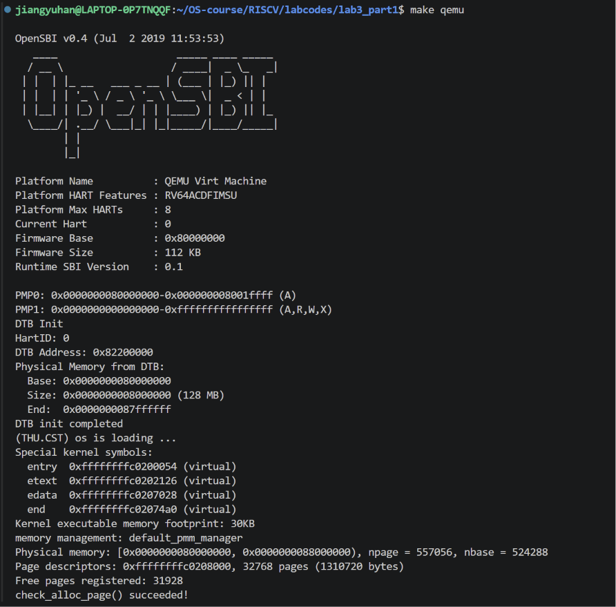
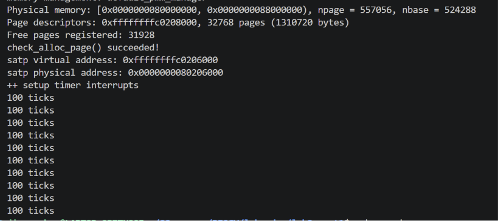
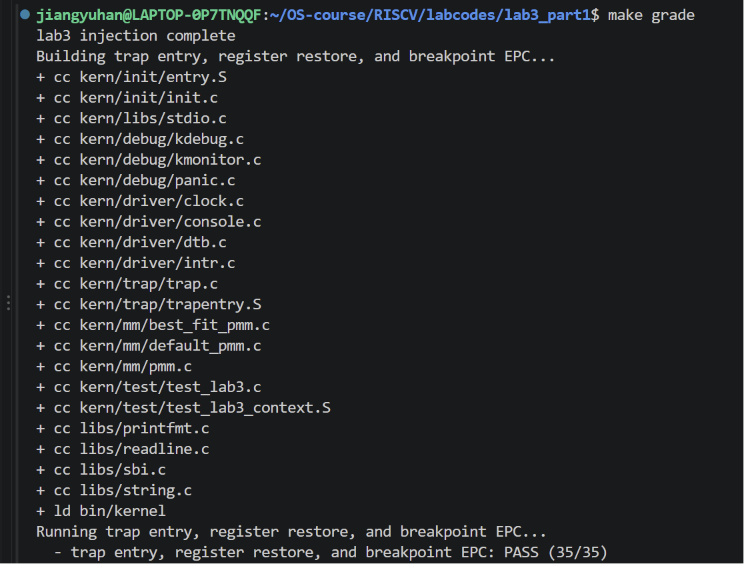
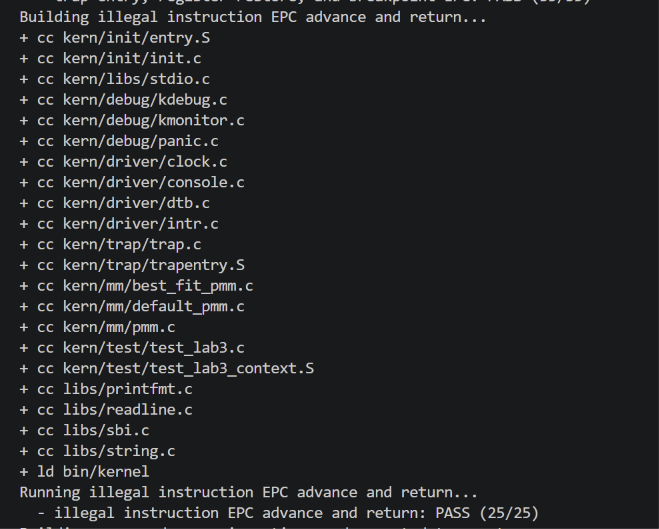
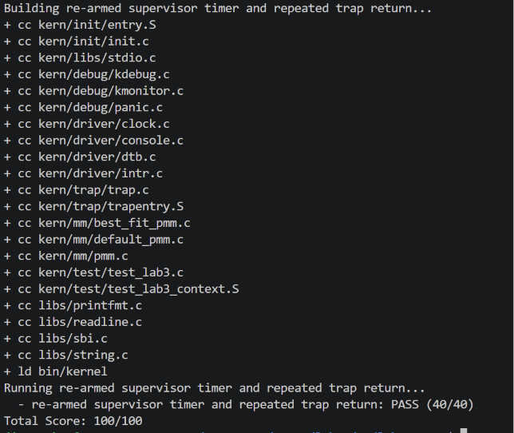

# Lab3实验报告

# 实验报告

## 实验基本信息

|项目|内容|
|---|---|
|**实验名称**|Lab 3：断，都可以断|
|**小组成员**|2510820\-侯思佳、2510725\-杨欣媛、2514207\-姜雨涵|
|**完成日期**|2026\-11\-5|

### 小组分工

练习分工

|成员|负责的练习/模块|
|---|---|
|2510820\-侯思佳|功能模块一：Trap 上下文恢复与 Trap 入口功能|
|2514207\-姜雨涵|功能模块二：中断与异常处理功能|
|2510725\-杨欣媛|模块一和模块二的校验工作|

实验报告分工

|成员|负责的练习/模块|
|---|---|
|2510820\-侯思佳|功能模块一|
|2514207\-姜雨涵|功能模块二|
|2510725\-杨欣媛|实验目的，整体逻辑分析，实验总结与收获|

---

## 一、实验目的

本实验的主要目的是：

1. 学习riscv 的中断相关知识

2. 学习中断前后如何进行上下文环境的保存与恢复

3. 学习处理最简单的断点中断和时钟中断

---

## 二、实验环境

|成员|AI 编程工具|底层模型|备注|
|---|---|---|---|
|2510820\-侯思佳<br>|Claude Code|DeepSeek\-V4\-Flash||
|2510725\-杨欣媛|Claude Code\(终端\)|DeepSeek\-V4\-Flash||
|2514207\-姜雨涵|Codex|GPT\-6\.1 Sol||

---

## 三、实验整体逻辑分析

### 2\.1 本章节的逻辑主线

本章围绕 RISC\-V 下Trap机制的完整实现展开，核心主题是：让内核具备“被打断后能保存现场、进入 C 语言处理、处理完再恢复现场并返回原执行流”的能力。

整个实验解决的核心问题是：中断和异常随时可能发生，CPU 不能只靠普通函数调用处理它们，必须有一套硬件与软件配合的 Trap 入口、上下文保存/恢复、原因分派和返回机制。 具体包括：

- 硬件在 Trap 发生时自动设置 `sepc`、`scause`、`stvec` 等；

- 汇编入口 `__alltraps` 保存全部寄存器，构造 `trapFrame`；

- C 函数 `trap()` 按 `scause` 分派给 `interrupt_handler()` 或 `exception_handler()`；

- 处理完成后 `RESTORE_ALL` 恢复现场，`sret` 返回；

- 时钟中断通过“每次处理时再设下一次”的方式形成周期性中断；

- 内核在修改关键数据结构时通过关中断保证原子性。

所以本章的逻辑主线可以概括为：从“能产生 Trap”到“能完整处理 Trap 并返回”，形成 Trap 处理的闭环。

### 2\.2 功能的逐步实现

本章按“上下文保存与恢复 → Trap 入口与返回 → 中断与异常处理 → 时钟中断 → 中断开关与原子性”的顺序逐步实现，原因如下。

1\. 首先实现 `RESTORE_ALL` 和 `__alltraps` 的调用关系

- 先完成上下文恢复和 Trap 入口，是因为整个 Trap 处理的前提是“现场能存下来、也能恢复回去”。

- `SAVE_ALL` 已经提供了保存逻辑，`RESTORE_ALL` 必须与它严格对应，尤其要特殊处理 `x2/sp`：`SAVE_ALL` 中 `sp` 是先暂存到 `sscratch`、最后填到 `gpr[2]`，所以恢复时不能简单按普通寄存器处理，否则栈指针会错。

- `__alltraps` 负责在 `SAVE_ALL` 后把 `trapFrame` 指针按 RISC\-V 调用约定传给 `trap(struct trapframe *tf)`，让 C 能接手。

- 这一步完成后，系统才具备“Trap 进入 → 保存 → C 处理 → 恢复 → 返回”的底层闭环。没有它，后面的中断/异常处理函数即使写了也接不上。

2\. 接着实现 `interrupt_handler()` 和 `exception_handler()` 的分派与处理

- 有了完整的 Trap 入口和 `trapFrame`，C 层才能拿到 `cause`、`epc`、各寄存器值。

- `trap_dispatch()` 先用 `scause` 最高位区分中断和异常，再分别交给两个 handler。

- `interrupt_handler()` 处理时钟中断等异步事件；`exception_handler()` 处理非法指令、断点等同步异常，并按异常类型正确更新 `tf->epc`，避免返回后重复执行触发异常的指令形成异常循环。

- 这一步是 Trap 机制的“业务处理层”，让 Trap 不只是保存和恢复，而是能对具体事件做出响应。

3. 然后完成时钟中断的初始化与周期触发

- 时钟中断是本章最典型的中断实例，也是后续调度的时间基础。

- 由于 OpenSBI 的 `sbi_set_timer()` 一次只能设定一个到期时间，不能自动周期重复，所以 `clock_init()` 先设第一个时钟中断，之后每次时钟中断处理时再调用 `clock_set_next_event()` 设下一次，形成周期性中断。

- 时钟中断处理中要累加 `ticks`，每 `TICK_NUM` 次输出统计信息，达到规定次数后关机。这验证了“中断能持续产生并被正确处理”的闭环。

- 先做时钟中断，是因为它不依赖复杂外设，又能反复触发，最适合验证 Trap 入口、分派、返回的完整路径。

4. 最后补充中断关闭/开启与原子操作

- 中断机制完整后，还要解决“有些关键操作不能被中断打断”的问题。

- `kern/sync/sync.h` 提供 `local_intr_save()` / `local_intr_restore()`：先保存 `sstatus.SIE` 状态并关中断，操作完再按原状态恢复，保证修改内存管理数据结构等关键操作的原子性。

- 这一步是对 Trap 机制的补充：Trap 要能进得来，也要能在必要时暂时关掉，形成“可处理中断”与“可控中断”的完整能力。

---

## 四、实验内容与实现

### 功能模块一：Trap 上下文恢复与 Trap 入口功能

**负责人：2510820\-侯思佳**

#### 模块功能描述

**需要实现/修改的函数：**

本模块主要修改 `kern/trap/trapentry.S` 中的两个部分：

1. `RESTORE_ALL`：汇编宏，负责从 Trapframe 中恢复通用寄存器和相关 CSR。

2. `__alltraps`：Trap 统一入口，负责保存 Trap 上下文后调用 C 语言中的 `trap()` 函数。

此外，使用已有的 `SAVE_ALL` 宏完成上下文保存，并通过已有的 `__trapret` 标签执行上下文恢复和异常返回。

**功能说明：**

1. **该模块在整个系统中的作用：**

本模块负责实现操作系统 Trap 处理过程中的上下文恢复与入口衔接，是连接 RISC\-V 汇编层和 C 语言 Trap 处理程序的重要部分。

当处理器发生中断或异常时，首先进入统一的 Trap 入口 `__alltraps`，通过 `SAVE_ALL` 保存当前执行环境中的通用寄存器和相关 CSR，形成完整的 Trapframe。随后将 Trapframe 的首地址作为参数传递给 C 语言函数 `trap()`，使内核能够在 C 语言层面进一步处理 Trap。

当 C 语言处理函数执行完成后，程序进入 `__trapret`，通过 `RESTORE_ALL` 将此前保存的寄存器和 CSR 恢复到原来的状态，最后执行 `sret` 指令，使处理器返回 Trap 发生前的执行流。

因此，本模块的核心作用是保证 Trap 发生前后的处理器上下文能够正确保存和恢复，使中断与异常处理过程具备完整的入口和返回机制。

2. **需要处理的主要场景：**

- **Trap 入口场景：** 当处理器发生中断或异常时，能够正确进入 `__alltraps`，执行已有的 `SAVE_ALL`，保存当前处理器上下文。

- **Trapframe 参数传递场景：** 将保存后的 Trapframe 首地址通过 `a0` 寄存器传递给 `trap()`，满足 RISC\-V LP64 ABI 的函数参数传递约定。

- **通用寄存器恢复场景：** 从 Trapframe 中按照 `SAVE_ALL` 对应的偏移恢复 x1、x3～x31，保证寄存器恢复位置与保存位置一致。

- **特殊寄存器恢复场景：** 对原始 `sp` 进行单独恢复，避免提前修改栈指针导致后续 Trapframe 数据无法正确访问。

- **CSR 恢复场景：** 从 Trapframe 中恢复 `sstatus`、`sepc`、`sbadaddr` 和 `scause`，保证返回时处理器状态和返回地址正确。

- **Trap 返回场景：** C 语言处理函数执行完成后，进入 `__trapret`，完成上下文恢复，并通过 `sret` 返回原执行流。

3. **与其他模块的交互关系：**

- **与上下文保存机制的关系：** 本模块依赖已有的 `SAVE_ALL` 宏。`SAVE_ALL` 负责保存寄存器和 CSR，`RESTORE_ALL` 按照相同的 Trapframe 布局恢复数据，二者必须保持偏移和数据结构一致。

- **与 Trapframe 数据结构的关系：** 本模块依赖 `trap.h` 中定义的 `struct trapframe` 及其寄存器布局，必须保证汇编中的偏移与 C 语言结构体字段排列一致。

- **与 C 语言 Trap 处理程序的关系：** `__alltraps` 通过 `a0` 将 Trapframe 地址传递给 `trap()`，由 C 语言处理程序完成后续 Trap 分发和处理。

- **与异常返回机制的关系：** `RESTORE_ALL` 完成上下文恢复后，通过 `sret` 使用恢复后的 `sstatus` 和 `sepc` 返回原执行流。

- **与其他功能模块的关系：** 本模块为后续中断与异常处理功能提供统一的上下文入口和返回机制，但不负责实现具体的中断处理函数或异常处理函数。

---

#### 最终提示词

以下是生成最终提示词前的spec：

```Markdown
功能模块一：Trap 上下文恢复与 Trap 入口功能 Spec
1. 任务目标：
完成 Trap 从“进入内核”到“返回原执行流”之间的底层上下文管理，使系统形成完整的“Trap 进入 -> 上下文保存 -> C 语言处理 -> 上下文恢复 -> Trap 返回”闭环。
2. 功能要求：
完善 RESTORE_ALL，使其与 SAVE_ALL 对应，正确恢复寄存器和 CSR。
完善 __alltraps，完成 Trap 上下文保存，并调用 trap() 函数。
3. 实现要求：
保持原有Trapframe数据结构和寄存器偏移不变。
遵循RISC-V的寄存器使用规范和函数调用约定。
保证原始sp能够正确恢复。
只修改kern/trap/trapentry.S中指定的部分，不影响其他任何代码。
使函数正确地满足对外接口，实现将Trap上下文正确传递给C语言Trap处理函数
4. 测试要求：
检查寄存器和CSR是否正确保存、恢复。
检查trap()函数是否能够正常调用。
尝试在不影响其它任何文件和环境的情况下编译项目，确认修改没有引入新的错误。
5. 预期结果：
Trap发生后能够正确保存上下文，完成处理后恢复原有现场，并正常返回。
```

以下是经过迭代优化后，最终成功实现该功能的提示词：

```Markdown
我正在完成操作系统实验Lab3，当前需要实现功能模块一：Trap上下文恢复与Trap入口功能。

先阅读项目中的相关源代码，充分理解现有的Trapframe内存布局、SAVE_ALL宏的实现方式以及RISC-V汇编调用约定，然后在现有代码基础上完成指定功能。

一、需要读取的文件

请优先阅读以下文件，不要在不了解现有代码的情况下直接编写实现：

1.kern/trap/trapentry.S：
重点阅读已经实现的SAVE_ALL宏。
查看__alltraps、__trapret和RESTORE_ALL的现有代码及预留位置。
明确SAVE_ALL对通用寄存器、sp和CSR的保存顺序及偏移量。
2.kern/trap/trap.h：
阅读structpushregs和structtrapframe的定义。
明确各个寄存器及CSR在Trapframe中的排列顺序。
3.kern/trap/trap.c：
阅读trap(structtrapframe*tf)的函数定义及调用关系。
理解C语言Trap处理函数如何接收Trapframe。
4.Makefile和tools/function.mk：
了解项目使用的交叉编译工具链及汇编文件编译方式。

如果上述文件中存在其他与Trapframe或汇编宏实现直接相关的定义，也可以进一步阅读，但不要修改其他任何文件。

二、需要实现的函数和汇编功能

本模块只需要实现kern/trap/trapentry.S中的以下两个部分：

1.RESTORE_ALL宏

功能：
实现Trap上下文恢复功能，与现有的SAVE_ALL宏严格对应。

具体要求：
从当前内核栈顶的Trapframe中读取之前保存的处理器上下文。
按照structpushregs和structtrapframe的实际内存布局恢复通用寄存器。
恢复保存的sstatus、sepc等CSR状态。
正确恢复原始栈指针sp。
保证所有需要恢复的寄存器都与SAVE_ALL中的保存位置一一对应。
恢复完成后，为后续执行sret做好准备。

特别注意：
SAVE_ALL对x2(sp)的保存方式与其他通用寄存器不同。
SAVE_ALL通过csrwsscratch,sp暂存原始sp，随后分配Trapframe空间，最后通过csrrws0,sscratch,x0取出原始sp并保存到Trapframe的2*REGBYTES(sp)位置。

因此，RESTORE_ALL必须根据这一保存方式恢复原始sp，不能简单地将所有寄存器使用相同的LOAD方式恢复。

2.__alltraps入口

功能：
建立汇编 Trap 入口与 C 语言 trap(struct trapframe *tf) 之间的调用关系，使保存后的 Trap frame 能够按照 RISC-V 调用约定正确传递给 trap()

具体要求：
首先执行已经提供的SAVE_ALL，保存当前Trap上下文。
获取当前Trapframe的起始地址。
按照RISC-V64位函数调用约定，将Trapframe地址作为第一个参数传递给C函数。
调用trap(structtrapframe*tf)。
保证调用过程中不会破坏后续恢复Trapframe所需要的信息。
trap()返回后，能够顺利进入__trapret。
由__trapret调用RESTORE_ALL，最后通过sret返回原执行流。

三、函数接口声明
本模块需要遵循以下已有接口：
1.C语言处理函数：
voidtrap(structtrapframe*tf);

2.Trapframe结构体：
structpushregs{
uintptr_tzero;
uintptr_tra;
uintptr_tsp;
uintptr_tgp;
uintptr_ttp;
uintptr_tt0;
uintptr_tt1;
uintptr_tt2;
uintptr_ts0;
uintptr_ts1;
uintptr_ta0;
uintptr_ta1;
uintptr_ta2;
uintptr_ta3;
uintptr_ta4;
uintptr_ta5;
uintptr_ta6;
uintptr_ta7;
uintptr_ts2;
uintptr_ts3;
uintptr_ts4;
uintptr_ts5;
uintptr_ts6;
uintptr_ts7;
uintptr_ts8;
uintptr_ts9;
uintptr_ts10;
uintptr_ts11;
uintptr_tt3;
uintptr_tt4;
uintptr_tt5;
uintptr_tt6;
};

structtrapframe{
structpushregsgpr;
uintptr_tstatus;
uintptr_tepc;
uintptr_tbadvaddr;
uintptr_tcause;
};
注意：以上结构体仅用于说明已有Trapframe的内存布局，不允许重新定义或修改结构体。
3.汇编入口和返回标签：
__alltraps
__trapret
4.已有宏：
SAVE_ALL
RESTORE_ALL（需要实现）

四、实现约束和可用接口
实现时必须遵循以下约束：
1.必须使用RISC-V64位汇编语法，符合当前项目的编译环境。
2.RESTORE_ALL必须严格按照SAVE_ALL的保存顺序和偏移量恢复寄存器以及宏定义和函数定义等接口，不能自行设计新的Trapframe布局。
3.Trapframe总共占用36个REGBYTES：
32个通用寄存器位置；
4个CSR保存位置。
4.通用寄存器的排列顺序为x0～x31，对应structpushregs的成员顺序。
5.CSR的保存顺序为：
32*REGBYTES(sp)：sstatus；
33*REGBYTES(sp)：sepc；
34*REGBYTES(sp)：sbadaddr；
35*REGBYTES(sp)：scause。
6.恢复原始sp时，必须特别处理x2的保存位置，确保恢复后的sp指向Trap发生之前的栈位置。
7.__alltraps必须按照RISC-VABI约定使用a0传递第一个参数，即当前Trapframe的起始地址。
8.调用C函数时，必须保证栈指针满足RISC-VABI的栈对齐要求。
9.不能因为调用trap()而破坏Trapframe中保存的原始寄存器状态。
10.sstatus和sepc必须恢复到对应的CSR中，不能仅恢复到普通通用寄存器。
11.最终通过sret返回，不能使用普通的ret代替。

五、修改过程中必须满足的要求和限制
1.只允许修改kern/trap/trapentry.S中与本模块有关的RESTORE_ALL和__alltraps预留实现位置，不允许修改其他任何文件以及本文件中其他的任何模块。
2.不允许修改已经提供的SAVE_ALL宏。
3.不允许修改structpushregs和structtrapframe的定义。
4.不允许修改trap(structtrapframe*tf)的函数签名和函数实现。
5.不允许修改__trapret中已有的整体返回流程和sret指令。
6.不允许修改其他文件，不允许为了通过编译而删除、绕过或替换已有功能。
7.不允许擅自引入新的全局变量、数据结构或额外的上下文保存机制。
8.不允许改变现有Trapframe的内存布局。
9..尽量保持原有代码结构、宏定义和注释，不要对无关代码进行格式化或重构。

六、完成后的检查要求

完成代码后，请执行以下检查：
1.检查RESTORE_ALL的每个LOAD偏移量是否与SAVE_ALL的STORE偏移量严格对应。
2.检查原始sp的恢复过程是否正确。
3.检查sstatus、sepc的CSR恢复过程是否正确。
4.检查__alltraps是否正确将Trapframe地址传递给trap()。
5.检查调用trap()前后的栈指针是否满足ABI对齐要求。
6.检查trap()返回后是否能够进入__trapret。
7.检查最终是否能够通过sret正确返回。
尽可能使用项目现有Makefile执行编译检查，如make、make debug等，并把编译结果给如实告诉我；如果编译失败，请分析错误原因并修复本模块引入的问题，不要通过修改其他任何模块和函数来规避错误。

七、最终回答格式

完成后，按照以下格式向我汇报：

1.读取的文件：列出实际阅读的文件及其作用。
2.实现的功能：分别说明RESTORE_ALL和__alltraps的实现思路。
3.修改的代码：给出kern/trap/trapentry.S中实际修改后的完整相关代码。
4.关键实现分析：重点解释寄存器恢复、原始sp恢复、CSR恢复、a0参数传递和函数调用过程。
5.编译检查结果：说明是否编译成功；如果失败，给出具体错误及原因。
6.修改范围确认：明确列出修改过的文件，并确认没有修改SAVE_ALL、trap.h、trap.c等不允许修改的内容。
必须在项目文件里实际修改你的代码，而不是仅仅展示你的代码。完成后，检查代码并尝试编译、运行测试，确认实现是否正确，如果需要测试的话，测试代码不要直接写在文件里。如果编译或测试失败，根据实际报错分析原因并修复。不要编造测试结果。如果无法运行，请告诉我具体原因和手动验证方法。
最后用简单易懂的话告诉我：你修改了哪些代码、每部分有什么作用、编译是否通过、运行测试是否通过。最后把修改的地方单独给我写出来。 @kern/ @tools/ @tools/
```


### 功能模块二：中断与异常处理功能

**负责人：** 2514207\-姜雨涵

#### 模块功能描述

**需要实现/修改的函数：**

```C
void interrupt_handler(struct trapframe *tf);(kern\trap\trap.c)
void exception_handler(struct trapframe *tf);(kern\trap\trap.c)
```

**功能说明：**

1. **该模块在整个系统中的作用**

    - 本模块负责 Trap 进入 C 语言处理流程后的具体处理，通过 `interrupt_handler()` 和 `exception_handler()` 分别处理中断与异常。

    - 根据 Trap frame 中保存的原因信息，识别时钟中断、非法指令、断点等事件，并执行相应操作，使内核能够响应运行过程中发生的事件。

    - 根据处理结果保留或调整返回地址，与上下文恢复流程衔接，保证程序能够从预期位置继续执行。

2. **需要处理的主要场景**

    - **时钟中断：** 每次收到 S 模式时钟中断后，设置下一次时钟事件，并将 `ticks` 增加一次；每累计 100 次中断输出一行统计信息，累计打印达到设定次数后调用关机接口。

    - **其他已知中断：** 对框架中定义的软件中断和外部中断进行分类，输出对应的类型提示。

    - **非法指令与断点异常：** 输出异常类型和发生异常的原指令地址，根据指令编码区分本实验中的 2 字节与 4 字节指令，更新 `tf->epc`，避免返回后重复执行同一条异常指令。

    - **未知中断和其他异常：** 调用 `print_trapframe()` 输出寄存器、返回地址、状态和原因等现场信息，辅助定位问题。其中未知中断还会额外输出原因码；兜底打印不负责修复异常。

3. **与其他模块的交互关系**

    - **与上下文保存模块交互：** 模块一中的 `SAVE_ALL` 将通用寄存器及相关控制寄存器保存到内核栈，形成 Trap frame，并将其地址传入 `trap()`，供本模块读取和使用。

    - **与 Trap 分发流程交互：** `trap_dispatch()` 根据 `cause` 的最高位区分中断和异常，分别调用本模块的两个处理函数；中断处理函数进一步去除最高位标志，按具体原因码选择处理分支。

    - **与时钟和 SBI 模块交互：** 使用时钟模块提供的 `ticks` 记录中断次数，通过 `clock_set_next_event()` 安排下一次事件，并在达到设定条件后调用 SBI 提供的 `sbi_shutdown()` 完成关机。

    - **与上下文恢复模块交互：** 正常处理结束后，控制流返回模块一，由 `RESTORE_ALL` 恢复寄存器，并将保留或更新后的 `tf->epc` 写回 `sepc`，最终通过 `sret` 返回并继续执行。

以下是经过迭代优化后，最终成功实现该功能的提示词：

**spec:**

```Markdown
1.** interrupt_handler**
void interrupt_handler(struct trapframe *tf);

Pre-Condition（前置条件）
- tf 指向有效的 Trap frame，tf->cause 包含中断原因信息。
- 处理时钟中断前，时钟模块已经初始化，ticks 用于记录累计时钟中断次数。
- TICK_NUM 为 100，SHUTDOWN_AFTER 为正整数。当前 Prompt 约定其默认值为 10，表示累计打印 10 次后关机。

Post-Condition（后置条件）
- 根据中断原因完成分类处理，识别具体原因时排除最高位中断标志的影响。
- 除达到关机条件外，处理完成后返回统一的 Trap 返回流程。
- 不修改 tf->epc 及其他保存的寄存器现场。

Case 1：S 模式时钟中断
- 设置下一次时钟事件，使时钟中断能够持续发生。
- 每处理一次时钟中断，ticks 恰好增加一次。
- 当累计次数达到 TICK_NUM 的整数倍时，调用已有的 print_ticks() 输出一行 100 ticks。
- 累计打印次数在多次调用之间保留；达到 SHUTDOWN_AFTER 次后，调用 sbi_shutdown() 关机。

Case 2：其他已知中断
- 对框架中定义的软件中断、其他时钟中断和外部中断输出对应的类型提示。
- S 模式软件中断的提示包含 Supervisor software interrupt。
- 不改变时钟计数和打印计数。

Case 3：未知中断
- 输出 Unknown interrupt: cause <十进制原因码>。
- 调用 print_trapframe(tf) 输出完整现场信息，辅助调试。
- 不改变时钟计数和打印计数。

Requirements
- 保持函数签名不变，复用已有的时钟、打印和 SBI 接口。
- 不在处理函数中主动开启中断。
- 不修改已有的 print_ticks() 和时钟驱动函数。

2. **exception_handler**
void exception_handler(struct trapframe *tf);

Pre-Condition（前置条件）
- tf 指向有效的 Trap frame，tf->cause 包含异常原因码。
- 对于非法指令和断点异常，tf->epc 指向可读取的实验指令；本实验考虑 16 位和 32 位指令。

Post-Condition（后置条件）
- 非法指令和断点异常处理后，tf->epc 指向下一条指令，避免返回后重复触发同一异常。
- 其他异常输出现场信息，并保持 tf->epc 不变。
- 不修改其他保存的寄存器现场，处理完成后返回统一的 Trap 返回流程。

Case 1：非法指令异常
- 输出以 Illegal instruction at 开头的信息，包含触发异常的原指令地址。
- 根据指令编码确定长度，将 tf->epc 前移对应的 2 字节或 4 字节。

Case 2：断点异常
- 输出以 Breakpoint at 开头的信息，包含断点指令的原地址。
- 根据指令编码确定长度，将 tf->epc 前移对应的 2 字节或 4 字节。

Case 3：其他异常
- 调用 print_trapframe(tf) 输出现场信息。
- 不读取 tf->epc 指向的指令内存，不修改返回地址，不执行额外的异常恢复操作。

Requirements
- 在更新 tf->epc 前输出原指令地址，地址输出应保留 RV64 地址宽度。
- 根据指令编码判断长度，不能按异常类型固定使用同一个偏移量。
- 保持函数签名和 Trap frame 结构不变，不修改已有的 Trap 分发与上下文恢复流程。
```

```Markdown

[PROMPT]

**任务**：在我现在打开的这个文件夹里面，即\\wsl.localhost\Ubuntu\home\jiangyuhan\OS-course\RISCV\labcodes\lab3_part1里直接按照如下prompt编写代码。完成 Lab3 功能模块二“中断与异常处理”，目标文件是 `kern/trap/trap.c`。模块一已经有实现，请沿用现有代码。
**操作要求**：必须修改项目实际文件，在 `//lab3 function2 2514207` 处补全实现。只允许补此模块及必需的头文件、内部宏和静态变量；不改已有其他函数、模块一汇编、Trap frame、内存管理器或评分测试。
**输出要求**：代码保持准确简单。完成后简述修改和验证结果；可运行时执行 `make`、`make grade`，说明普通 QEMU 下的打印与关机表现，不能运行就明确说明。

[RELY]

先阅读实际的'trap.c'、'trap.h'、'clock.c/h'、'libs/riscv.h'、'libs/sbi.h' 以及'tools/test_lab3.c'、'tools/grade.sh'。

1. struct trapframe含gpr和uintptr_t类型的status、epc、badvaddr、cause；epc会在返回时恢复到 sepc。
2. trap_dispatch()已按cause最高位区分中断与异常；中断分类仍需去掉最高位标志。
3. 已有TICK_NUM=100、extern volatile size_t ticks、clock_set_next_event()、print_ticks()、print_trapframe(tf)；print_ticks()输出：100 ticks。
4. 原因宏使用 libs/riscv.h的实际定义，包括IRQ_S_TIMER、IRQ_S_SOFT、CAUSE_ILLEGAL_INSTRUCTION、CAUSE_BREAKPOINT。
5. sbi_shutdown()在libs/sbi.h中声明，需要加入该头文件。
6. 当前工程未定义SHUTDOWN_AFTER。新增可由编译宏覆盖的默认值10，含义为打印10次统计信息后关机；这是本次约定值。

[GUARANTEE]

必须实现下面两个非 static 函数，签名不变：

```c
void interrupt_handler(struct trapframe *tf);
void exception_handler(struct trapframe *tf);
不增加其他公开接口，不修改无关寄存器快照。
```


#### 

---

## 五、测试与验证

**测试截图：**





如下为make grade








---

## 六、实验总结与收获

### 对操作系统的理解

#### （一）本实验中重要的知识点，以及与对应的 OS 原理中的知识点

#### 知识点一：上下文切换与现场保护

- 本实验中的含义：在 `trapentry.S` 中，通过汇编宏 `SAVE_ALL` 将 32 个通用寄存器压入栈中，构造 `trapFrame`；处理完后，通过 `RESTORE_ALL` 从栈中恢复这些寄存器。特别注意 `sp` 寄存器必须最后恢复。

- OS 原理中的含义：CPU 被中断打断或发生进程切换时，必须保存当前执行流的运行现场（寄存器状态、PC 等），以便未来能够无缝恢复执行。

- 二者的关系：实验中的 `SAVE_ALL` 是 OS 原理中“保存现场”概念在 RISC\-V 架构下的具体落地。

- 二者的差异：原理中通常只强调“要保存上下文”；而在本实验中，我们要严格区分硬件自动保存的部分（如 `sepc`、`scause` 等 CSR）和软件必须手动保存的部分（通用寄存器），并且必须严格遵守内存栈的布局和调用约定。

#### 知识点二：中断/异常的分派机制

- 本实验中的含义：硬件触发 Trap 后统一跳入 `__alltraps`，然后调用 C 函数 `trap()`。在 `trap()` 内部，根据 `scause` 寄存器的最高位，将其分派给 `interrupt_handler()` 或 `exception_handler()`，再根据低位原因码进行具体处理。

- OS 原理中的含义：操作系统需要对外部设备的异步中断和程序内部产生的同步异常进行分类响应，将控制流引导至正确的设备驱动或异常处理程序。

- 二者的关系：实验中的 `trap()` 分发逻辑就是 OS 原理中“中断向量表”与“中断服务例程（ISR）”的设计思路体现。

- 二者的差异：在传统的 OS 原理中，硬件会自动根据中断号查询中断向量表，跳转到不同的处理程序入口；而在本实验的 RISC\-V Direct 模式下，虽然也使用了 `stvec` 作为 Trap 向量寄存器，但它只指向唯一的一个统一入口（`__alltraps`）。硬件不做具体分派，而是由软件（C 语言的 `trap_dispatch` 函数）读取 `scause` 寄存器后进行二次分派（`switch-case`）。

#### 知识点三：原子操作与临界区保护

- 本实验中的含义：在物理内存分配等关键操作中，使用 `local_intr_save()` 和 `local_intr_restore()` 机制。先读取 `sstatus.SIE` 记录当前中断状态，然后关中断；操作完成后，再恢复之前的中断状态。

- OS 原理中的含义：并发环境下，对共享数据结构的修改必须保证原子性，通常通过互斥锁、信号量等机制实现临界区保护。

- 二者的关系：实验中的开关中断代码，是 OS 原理中“临界区保护”在单核处理器下的最基础实现手段。

- 二者的差异：OS 原理中强调的是多种同步互斥原语（如自旋锁、条件变量）；而在本实验中，聚焦于单核环境下通过硬件特权指令（开关 SIE 位）来实现底层的互斥保护。

#### 知识点四：时钟中断与系统滴答

- 本实验中的含义：通过 OpenSBI 接口设置一次性定时器，在时钟中断处理程序中不断重新设定下一次触发时间，从而模拟出周期性的时钟中断，并累加 `ticks` 变量。

- OS 原理中的含义：操作系统需要一个稳定的“心跳”来维护系统时间、驱动时间片轮转调度、实现延迟任务等。

- 二者的关系：实验中的 `ticks` 累加和周期性触发，是 OS 原理中“系统时钟滴答（System Tick）”功能的直接体现。

- 二者的差异：原理中常默认硬件提供自动周期触发的定时器；但在 RISC\-V/OpenSBI 架构下，硬件接口只支持“设置单次触发时间”，这要求 OS 必须依赖软件在每次中断时“续订”下一次中断，体现了操作系统对硬件特性的适配与封装。

#### （二）OS 原理中很重要、但在本实验中没有对应上的知识点

1. 多核并发控制（SMP 下的锁机制）：本实验运行在单核环境下，关中断即可解决大部分并发问题。在真实多核 OS 中，关中断只能屏蔽当前核心的中断，还需要依赖原子指令实现的自旋锁来保护全局数据。

2. 中断下半部：实验中的中断处理（如时钟中断）直接在关中断的上下文中完成了。在成熟的 OS 中，为了减少关中断时间，耗时的任务通常会被推迟到中断下半部（如 Softirq、Tasklet、工作队列）去执行。

3. 高级异常处理机制：本实验仅处理了断点和非法指令异常，未实现真正的虚拟内存缺页处理，即无法在访问未映射页面时动态分配物理页并建立映射。

### AI 协作开发的经验

1. Spec的准确性决定了代码的质量：对于汇编代码（如 `RESTORE_ALL`），AI 容易“幻觉”出错误的寄存器偏移。在编写 Prompt 时，必须明确告知 AI：“严格遵守 `SAVE_ALL` 的 36 个槽位布局”、“`x2(sp)` 必须最后恢复”。给出具体的结构体定义和架构约束，比单纯说“帮我写个恢复上下文的汇编”有效得多。

2. 不仅要“写代码”，还要 AI“解释代码”：在实现 `exception_handler` 时，我不清楚如何判断指令长度。我让 AI 解释了 RISC\-V 的指令对齐规则（低 2 位不是 11 则是 16 位），然后再让它生成对应的 C 语言处理代码，极大地提高了我的理解深度。

3. 框架约束不可打破：AI 有时会“好心办坏事”，试图去修改 `trap()` 的函数签名或者 `trapframe` 结构体。必须在 Prompt 中反复强调“不得修改框架已有接口”，否则编译会直接报错。

---


